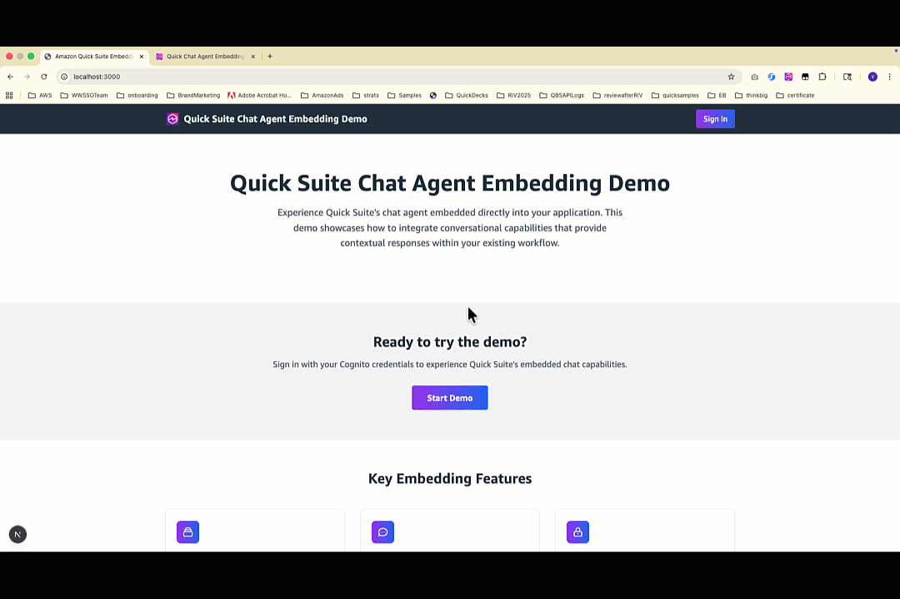
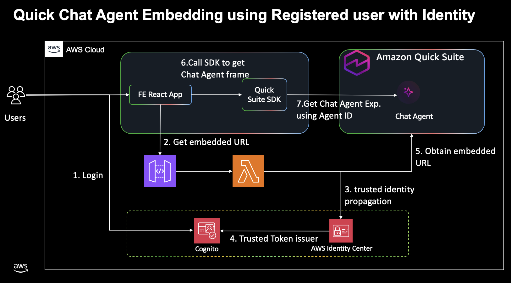

# Quick Chat Agent Embedding Demo

Bring AI-powered conversational intelligence directly into your applications with AWS Quick embedded chat. This demo shows how to integrate Quick's unified chat experience into your own web applications. The chat combines structured data insights, document knowledge, and actionable workflows.

This implementation uses the `generate_embed_url_for_registered_user_with_identity` API to create user-specific embed URLs with trusted identity propagation. Each authenticated user gets a chat experience tied to their own identity within your application.

## Business Value

With this pattern, you can:

- Embed AWS Quick chat agents into existing web applications
- Carry each user's identity into Quick with trusted identity propagation
- Scale chat functionality across multiple domains and applications
- Use AWS managed services for reliability and performance

## Demo



## Architecture



## Overview

Complete embedding solution with:

- **Next.js Frontend** with responsive chat interface
- **Amazon Cognito Authentication** for user sign-in and management
- **AWS Lambda Functions** for embedding URL generation
- **AWS CDK Infrastructure** for automated deployment
- **Session Management** with 10-hour token lifetime

## Project Structure

The demo has two parts, the CDK infrastructure and the Next.js frontend:

```text
 infrastructure/          # AWS CDK deployment code
    cdk-app.ts          # Main CDK application
    cloudformation.yaml # CloudFormation template
    deploy.sh           # Deployment script
 fe/                     # Next.js frontend application
     app/                # Next.js app router
     components/         # React components
     lib/                # Utility functions
```

## Getting Started

Deploy the infrastructure, create matching users, set the agent ID, and then start the frontend.

### 1. Clone Repository (Sparse Checkout)

Clone only this use case's files:

```bash
# Clone repository with sparse checkout
git clone --filter=blob:none --sparse https://github.com/aws-samples/sample-amazon-quick-suite-knowledge-hub.git
cd sample-amazon-quick-suite-knowledge-hub

# Configure sparse checkout for this use case only
git sparse-checkout set docs/use-cases/quick-chat-agent-embedding-demo
```

### 2. Deploy Infrastructure

For local development with default domain configuration:

```bash
cd infrastructure
./deploy.sh 'http://localhost:3000,https://yourdomain.com'
```

For detailed deployment instructions and options, see the `infrastructure/README.md` file.

### 3. Create Users

Before starting the frontend application, you must create matching users in both Amazon Cognito and AWS IAM Identity Center using the same email address.

#### Create Amazon Cognito User

Create the user that signs in to the web application:

1. Navigate to the AWS Console → Amazon Cognito
2. Go to **User pools** → Select your user pool
3. Go to **Users** → **Create user**
4. Enter your email address and set a password
5. Complete the user creation process

#### Create AWS IAM Identity Center User

Create the matching user that Quick sees:

1. Navigate to the AWS Console → AWS IAM Identity Center
2. Go to **Users** → **Add User**
3. Use the exact same email address as the Amazon Cognito user
4. Complete the user creation process

#### Why Both Users Are Required

Each user plays a different part in the sign-in chain:

- **Amazon Cognito User**: Authenticates the web application
- **AWS IAM Identity Center User**: Required for AWS Quick trusted identity propagation
- **Matching Email Addresses**: Links the identities so one sign-in carries through to Quick

**Important**: The email addresses must match exactly for trusted identity propagation to function correctly.

### 4. Configure AWS Quick Agent ID

Find the ID of the chat agent to embed, then add it to the frontend configuration:

1. Navigate to the Quick console
2. Go to **Explore** → **Chat agents**
3. In the **Action** column, select the options menu next to **Chat**
4. Choose **View chat agent details**
5. Select **Copy link** next to the chat agent name
6. Extract the agent ID from the URL:

   ```text
   https://us-east-1.quicksight.aws.amazon.com/sn/start/agents?view=6fxxxxxx-xxxx-xxxx-xxxx-xxxxxx43137d
   ```

7. The value after `view=` is your agent ID
8. Update the `.env.local` file in the `fe/` directory:

   ```text
   NEXT_PUBLIC_QUICKSUITE_AGENT_ID=your-agent-id-here
   ```

**Important**: Replace `REPLACE_WITH_YOUR_AGENT_ID` in the `.env.local` file with your actual agent ID before starting the frontend application.

### 5. Start the Frontend Application

Install the dependencies and start the development server:

```bash
cd fe
npm install
npm run dev
```

Access the application at `http://localhost:3000`

## Cleanup

To delete the deployed resources, run:

```bash
cd infrastructure
cdk destroy
```

## License

This project is licensed under the MIT No Attribution License. See the [LICENSE](https://github.com/aws-samples/sample-amazon-quick-suite-knowledge-hub/blob/main/LICENSE) file for details.
