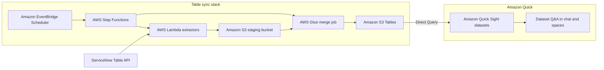

# How the ServiceNow table sync works

Amazon Quick queries tables in an Amazon S3 table bucket directly, in Direct Query or SPICE mode ([Creating a dataset using Amazon S3 Tables](https://docs.aws.amazon.com/quick/latest/userguide/create-a-data-set-s3-tables.html)). ServiceNow serves its records from a REST API, one page at a time. Getting from one to the other takes a job that pages through the API, remembers what it already copied, and writes the result as tables, and this project is that job for the tables you list.

The design follows from what you should and shouldn't have to do. You configure tables and credentials and nothing else, every table lands in the same format, and the stack uses managed services only, so no server needs patching or scaling.

## Architecture

[Amazon EventBridge Scheduler](https://aws.amazon.com/eventbridge/scheduler/) starts an [AWS Step Functions](https://aws.amazon.com/step-functions/) workflow at a fixed interval. The workflow runs [AWS Lambda](https://aws.amazon.com/lambda/) functions that pull records from the ServiceNow Table API into a staging bucket in [Amazon Simple Storage Service (Amazon S3)](https://aws.amazon.com/s3/), and then runs an [AWS Glue](https://aws.amazon.com/glue/) job that merges the staged files into [Amazon S3 Tables](https://docs.aws.amazon.com/AmazonS3/latest/userguide/s3-tables.html). Amazon Quick Sight datasets read those tables with Direct Query, and Dataset Q&A in chat and spaces answers questions against the datasets.



## Table configuration

The list of tables is a TypeScript constant, `TABLE_REGISTRY`, in `cdk/lib/common/table-registry-config.ts`. During deployment, an AWS Cloud Development Kit (AWS CDK) custom resource writes a row for each entry to an [Amazon DynamoDB](https://aws.amazon.com/dynamodb/) table named `ServiceNowIngestionTableMetadataTable`, and the `ListTables` function reads that table at the start of each run. The workflow therefore acts on whatever the last deployment wrote, and removing an entry deletes its row. Because the list lives in the CDK project, a table change is a reviewed code change that deploys with the stack.

Each row holds a table name, an enabled flag, an optional list of fields, and an optional ServiceNow encoded query. The defaults are the standard tables for IT Service Management (`incident`, `change_request`, `problem`), the Service Catalog (`sc_request`, `sc_req_item`), service level agreements (`task_sla`), and the configuration management database (CMDB) (`cmdb_ci_server`, `cmdb_ci_appl`). The list uses `task_sla` because it holds the SLA records attached to tasks, while `contract_sla` holds only the SLA definitions.

## Workflow

A Step Functions Standard workflow runs each sync:

```text
ListTables
  -> ExtractTables
  -> NormalizeTables
  -> ExtractDeletes
  -> NormalizeDeletedTables
  -> IngestionSucceeded
```

`ListTables` returns the enabled rows. `ExtractTables` runs a Lambda invocation for each table, up to the concurrency limit that `EXTRACT_MAX_CONCURRENCY` sets in `cdk/lib/construct-groups/ingestion-workflow.ts`, which bounds the request rate to ServiceNow. Each invocation queries the Table API for records changed since the last checkpoint and writes them as Parquet under `staging/<table>/` in the staging bucket.

`NormalizeTables` starts the Glue job for each table that returned records. `ExtractDeletes` then queries the ServiceNow `sys_audit_delete` table for each table and writes the deleted `sys_id` values to a manifest, and `NormalizeDeletedTables` starts the same Glue job for each table that has deletions. Updates are applied before deletions, so a record that was updated and then deleted within a window ends deleted.

Every task retries a failure with exponential backoff, as `TRANSIENT_RETRY` defines in the same file, and a failure that survives the retries ends the execution in the `IngestionFailed` state. The state machine writes its execution history to Amazon CloudWatch Logs with a finite retention period and sends traces to AWS X-Ray. If EventBridge Scheduler can't start the workflow, it sends the event to an Amazon Simple Queue Service (Amazon SQS) dead-letter queue.

## Incremental sync

Another DynamoDB table, `ServiceNowIngestionIngestionCheckpointTable`, stores a checkpoint for each ServiceNow table: the greatest `sys_updated_on` value written so far and the status of the last run. The next run adds `sys_updated_on>=<checkpoint>` to the query. A separate checkpoint, keyed `<table>#deletes`, tracks `sys_audit_delete` the same way.

A checkpoint advances only after a table's Parquet files are written, so a failed run reads the same window again. The Glue job merges on `sys_id`, so reading a window twice updates the same rows instead of adding duplicates. The first run has no checkpoint and reads every matching record.

## Unified table format

Each ServiceNow table becomes an Apache Iceberg table in the `servicenow` namespace of the table bucket, named after the ServiceNow table, and every table follows the same rules:

- Every column is a string, so the sync needs no per-table type mapping. You set types such as dates and numbers when you prepare the dataset in Amazon Quick Sight.
- The extractor requests display values, so reference and choice fields hold readable text, such as an assignee's name, in place of a `sys_id` or an internal code.
- The merge key is `sys_id`. An update replaces the row and a deletion removes it.

The Glue job creates a table from the columns of its first batch and never adds columns to an existing table. If you change a table's `fields` setting, reload the table as the runbook describes.

## Storage and encryption

The staging bucket holds Parquet files until the Glue job merges them, and then the job deletes them. The table bucket holds the curated Iceberg tables, and S3 Tables handles compaction and snapshot cleanup for them.

All encryption is service-managed. The staging bucket, the access-log bucket, and the table bucket use Amazon S3 managed encryption (SSE-S3). S3 Tables supports only customer managed keys for server-side encryption with AWS Key Management Service (SSE-KMS) ([Protecting S3 table data with encryption](https://docs.aws.amazon.com/AmazonS3/latest/userguide/s3-tables-encryption.html)), so SSE-S3 is the service-managed choice. The DynamoDB tables use the AWS managed key, the dead-letter queue uses Amazon SQS managed encryption, and the log groups use the CloudWatch Logs default.

The stack creates no AWS KMS key, so you have no key to rotate, no key policy to maintain, and no extra permission to grant to Amazon Quick. It also means you can't revoke access to the data by disabling a key, so access control rests on AWS Identity and Access Management (IAM) and on Amazon Quick sharing.

## Authentication

The Lambda functions authenticate to ServiceNow with the OAuth 2.0 client credentials grant through the [PySNC](https://servicenow.github.io/PySNC/) library. The client ID and secret come from an [AWS Secrets Manager](https://aws.amazon.com/secrets-manager/) secret with a fixed name, `ServiceNowIngestionServiceNowCredentials`, which holds the keys `instance_url`, `client_id`, `client_secret`, and `grant_type`. You create the secret before you deploy. The stack imports it by name and grants the extraction functions read access to that secret only, so the credentials never pass through CDK code, a template, or a log. The runbook covers creating the OAuth application and the secret.

## IAM

Each Lambda function gets only the grants it uses: read on the table list, read and write on the checkpoint table and the staging bucket, and read on the secret. The Glue role can read and delete staging objects, work with the table bucket and its namespace, use this account's Glue Data Catalog, and write to its own job log groups. The state machine can invoke the extraction functions and start the Glue job. The wildcards that remain come from CDK grant methods, and the cdk-nag suppressions give the reason for each one.

## Stacks

`ServiceNowIngestionStack` is the table sync and the only stack in the app by default.

`ServiceNowIngestionTestStack` is optional and disposable. The app includes it only when you pass `--context enableTestStack=true`. It creates its own secret, table bucket, and pipeline, plus a ServiceNow simulator behind Amazon API Gateway, so you can watch the sync work without a ServiceNow instance. Its schedule is always off.

Each stack uses the `DESTROY` removal policy, so `cdk destroy` removes its resources. The exception is the table bucket, which can't be deleted while it holds tables, so the cleanup steps in the runbook delete the tables first.

## Failure behavior

A ServiceNow, Lambda, or Glue error fails the execution after the retries. The checkpoint for a failed table stays where it was, so the next run covers the same window, and because the merge is idempotent you can start a new execution as soon as you fix the cause.

## Limits and decisions

Plan around these limits before you add a large table or promise a team a freshness target.

- Each table is extracted in a single Lambda invocation, so a table must finish within the Lambda timeout, which `EXTRACT_TIMEOUT` sets in `cdk/lib/construct-groups/extraction-lambdas.ts` and which can't exceed the [Lambda maximum](https://docs.aws.amazon.com/lambda/latest/dg/configuration-timeout.html). A very large first load needs a `baseQuery` that limits the history.
- The sync copies the rows that the integration user can read. It doesn't copy ServiceNow access rules, so you control access through Amazon Quick sharing.
- The sync reads deletions from `sys_audit_delete`, so a table with the `no_audit_delete` attribute doesn't propagate deletions.
- The schedule is a fixed rate that `SYNC_INTERVAL_HOURS` sets. You can turn it off or start a run by hand at any time.
- Amazon Quick datasets use Direct Query. A dataset that is slow in Direct Query can switch to SPICE without any change to the sync.
