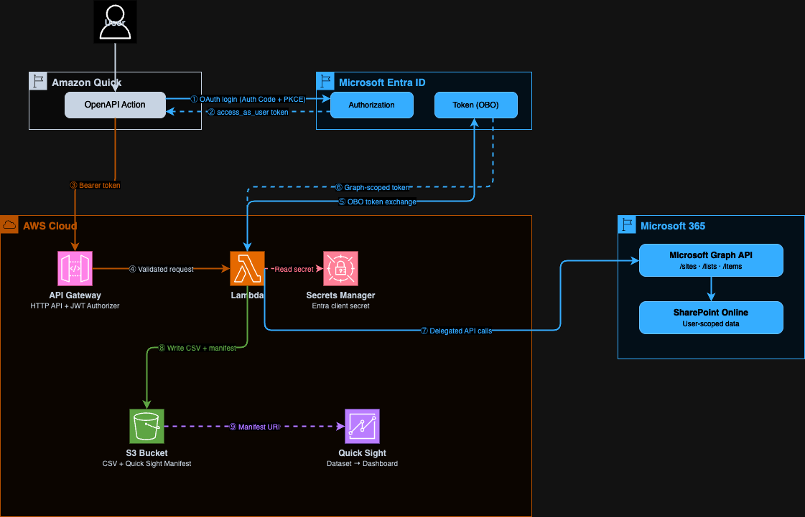

# Export SharePoint List to AWS Quick Sight Dataset

This project lets users export SharePoint lists to Quick Sight through natural language in AWS Quick. A user asks Quick to export a list, and Quick calls a REST API protected by Microsoft Entra OAuth. The list data lands in S3 as a CSV with a Quick Sight manifest, ready to build a dashboard from.

Note the following about access and scope:

- **Every API call is scoped to the authenticated user's SharePoint permissions.** The system never uses application-level access to SharePoint. If a user cannot read a list in SharePoint, they cannot export it through this API.
- **Why not use the SharePoint native Quick integration?** Lists can exceed thousands of rows and exporting data to Amazon S3 from Quick still requires a custom integration over S3. This solution uses your Microsoft credentials and your infrastructure to export data. You can schedule this export by using AWS Quick Flows and refresh the data periodically in Quick Sight datasets.

---

## How It Works

Each request follows the same path from Quick to Microsoft Graph and back:

1. A user in AWS Quick asks to search for SharePoint sites, browse lists, or export a list
2. AWS Quick calls the API by using the user's Entra OAuth token (delegated permissions)
3. API Gateway validates the JWT, checking issuer, audience, and scope
4. The Lambda function exchanges the user's token for a Microsoft Graph token by using the **On-Behalf-Of (OBO) flow**
5. The Lambda calls Microsoft Graph API with the Graph token, which returns only data the user can access
6. For exports, the Lambda writes list items to S3 as CSV alongside a Quick Sight manifest file
7. The user pastes the manifest URI into Quick Sight to create a dataset and build dashboards



---

## API Operations

| Operation | Method | Path | Description |
|---|---|---|---|
| `search_sites` | GET | `/sites?query=` | Search SharePoint sites the user has access to |
| `list_lists` | GET | `/sites/{site_id}/lists` | Get all lists in a SharePoint site |
| `export_list` | POST | `/sites/{site_id}/lists/{list_id}/export` | Export a list to CSV + Quick Sight manifest in S3 |

---

## Security Model

This project uses **delegated user authentication end to end**. The project doesn't use a service account, application-level SharePoint access, or stored user credentials.

### How the On-Behalf-Of (OBO) Flow Works

The OBO flow is an OAuth 2.0 extension defined in [RFC 8693 (Token Exchange)](https://datatracker.ietf.org/doc/html/rfc8693) and implemented by Microsoft Entra. It allows a middle-tier service (this Lambda) to call a downstream API (Microsoft Graph) on behalf of the user who initiated the request. The user doesn't need to sign in again.

**Step by step:**

1. AWS Quick authenticates the user against your Entra app registration by using Authorization Code + PKCE
2. The user receives an access token scoped to `api://{client-id}/access_as_user`, a custom scope on your app
3. AWS Quick sends this token to API Gateway in the `Authorization: Bearer` header
4. API Gateway's JWT authorizer validates the token: issuer must be `https://login.microsoftonline.com/{tenant-id}/v2.0`, audience must be your client ID
5. The Lambda extracts the bearer token and calls Entra's token endpoint with:
   - `grant_type=urn:ietf:params:oauth:grant-type:jwt-bearer`
   - `assertion=<user's token>`
   - `requested_token_use=on_behalf_of`
   - `scope=https://graph.microsoft.com/.default`
6. Entra validates that the user consented to `Sites.Read.All` and issues a new Graph-scoped token **for that user**
7. The Lambda calls Microsoft Graph with this token, and Graph enforces the user's SharePoint permissions

**References:**

- [Microsoft identity platform and OAuth 2.0 On-Behalf-Of flow](https://learn.microsoft.com/en-us/entra/identity-platform/v2-oauth2-on-behalf-of-flow)
- [Microsoft Graph permissions reference: Sites.Read.All](https://learn.microsoft.com/en-us/graph/permissions-reference#sitesreadall)
- [Configure delegated permissions for Microsoft Graph](https://learn.microsoft.com/en-us/graph/auth-v2-user)

### What This Means for Data Access

Because every call runs with the user's own token:

- A user can only export lists they can read in SharePoint
- The Lambda never stores user tokens
- AWS Secrets Manager stores the Entra client secret (used only for the OBO exchange), and the secret is never exposed to users
- API Gateway rejects any request with an invalid, expired, or incorrectly scoped token before it reaches the Lambda

---

## Prerequisites

You need the following accounts, roles, and tools:

- AWS account with AWS Quick and Quick Sight enabled
- Microsoft 365 tenant with SharePoint
- Access to the Microsoft Entra admin center (Global Administrator or Application Administrator role)
- Node.js 18+ and AWS CDK CLI (`npm install -g aws-cdk`)
- Python 3.12+ and [uv](https://docs.astral.sh/uv/)
- Docker or finch to build the AWS Lambda images

---

## Step 1: Register a Microsoft Entra Application

This app registration is the identity bridge between AWS Quick and Microsoft Graph. AWS Quick authenticates users against it, and the Lambda uses it to perform the OBO exchange.

### 1.1 Create the Registration

Create the app registration in the Entra admin center:

1. Open the [Microsoft Entra admin center](https://entra.microsoft.com/)
2. Go to **Identity** → **Applications** → **App registrations**
3. Choose **New registration**
4. Fill in:
   - **Name**: `AWS Quick SharePoint Export`
   - **Supported account types**: `Accounts in this organizational directory only`
   - **Redirect URI**: Platform = **Web**, URI = `https://{region}.quicksight.aws.amazon.com/sn/oauthcallback`
     > Replace `{region}` with your AWS Region (for example, `us-east-1`)
5. Choose **Register**

### 1.2 Record Your IDs

From the app registration **Overview** page, copy:

| Value | Where to find it | Used in |
|---|---|---|
| **Application (client) ID** | Overview page | CDK deploy, AWS Quick config |
| **Directory (tenant) ID** | Overview page | CDK deploy, AWS Quick config |

### 1.3 Create a Client Secret

The Lambda needs a client secret for the OBO exchange:

1. Choose **Certificates & secrets** → **New client secret**
2. Enter a description (for example, `AWS Quick SharePoint Lists Export Secret`) and choose an expiry
3. Choose **Add**
4. **Copy the Value immediately.** It appears only once

> The Lambda uses this secret for the OBO token exchange only. AWS Secrets Manager stores the secret, and it is never sent to users or AWS Quick.

### 1.4 Set Token Version to v2.0

The API Gateway JWT authorizer requires v2.0 tokens.

1. Choose **Manifest**
2. Find `accessTokenAcceptedVersion` and change it to `2`:

   ```json
   "accessTokenAcceptedVersion": 2
   ```

3. Choose **Save**

### 1.5 Add API Permissions

Add the delegated Microsoft Graph permissions the export needs:

1. Choose **API permissions** → **Add a permission** → **Microsoft Graph** → **Delegated permissions**
2. Search for and add:
   - `Sites.Read.All`: Read items in all site collections on behalf of the signed-in user
   - `offline_access`: Maintain access to data the user has granted access to
3. Choose **Grant admin consent for [your tenant name]**
4. Confirm every permission shows **Granted** status

> `Sites.Read.All` is a delegated permission. It only grants access to sites the signed-in user can already access. For details, see [Microsoft's documentation](https://learn.microsoft.com/en-us/graph/permissions-reference#sitesreadall).

### 1.6 Expose an API (Custom Scope)

This step creates the `access_as_user` scope that Quick requests when it authenticates users. Before it performs the OBO exchange, the Lambda checks that the token carries this scope.

1. Choose **Expose an API**
2. Next to **Application ID URI**, choose **Add**, and accept the default `api://{client-id}`
3. Choose **Add a scope**:
   - **Scope name**: `access_as_user`
   - **Who can consent**: Admins and users
   - **Admin consent display name**: `Access SharePoint Export`
   - **Admin consent description**: `Allow the app to export SharePoint lists on behalf of the user`
   - **State**: Enabled
4. Choose **Add scope**

---

## Step 2: Deploy the AWS Infrastructure

The CDK stack deploys API Gateway, Lambda, S3, and Secrets Manager. The `ResolvedOpenApiSpec` output is the fully populated OpenAPI spec you paste into AWS Quick.

### 2.1 Install Dependencies

Install the CDK app's packages:

```bash
cd infra
npm install
```

### 2.2 Deploy

Deploy the stack with your Entra tenant and client IDs:

```bash
npx cdk deploy \
  -c entraTenantId=YOUR_TENANT_ID \
  -c entraClientId=YOUR_CLIENT_ID
```

### 2.3 Store the Client Secret

The stack creates a Secrets Manager secret named `QuickSpExport/entra-client-secret`. Populate it with the secret value from Step 1.3:

```bash
aws secretsmanager put-secret-value \
  --secret-id QuickSpExport/entra-client-secret \
  --secret-string 'YOUR_CLIENT_SECRET_VALUE'
```

> **Important:** Do not invoke the Lambda before storing the secret. The Lambda reads the secret at cold start, and if the secret is empty, the OBO token exchange fails.

### 2.4 Stack Outputs

After deployment, CDK prints the outputs below, which you need in Step 3 and Step 4.

| Output | Description |
|---|---|
| `ApiEndpoint` | API Gateway endpoint URL |
| `ExportBucketName` | S3 bucket name for exported CSV and manifest files |
| `QuickIntegrationClientId` | Entra client ID to paste into AWS Quick |
| `QuickIntegrationTokenUrl` | Entra token URL to paste into AWS Quick |
| `QuickIntegrationAuthorizationUrl` | Entra authorization URL to paste into AWS Quick |
| `ResolvedOpenApiSpec` | Fully resolved OpenAPI spec JSON for the AWS Quick OpenAPI integration |

### What Gets Deployed

| Resource | Purpose |
|---|---|
| **API Gateway HTTP API** | Routes requests, enforces Entra JWT authorization |
| **Lambda Function** | Handles OBO exchange, calls Microsoft Graph, writes to S3 |
| **S3 Bucket** | Stores exported CSV files and Quick Sight manifest files |
| **Secrets Manager Secret** | Stores the Entra client secret for OBO exchange |

---

## Step 3: Configure the OpenAPI Plugin in AWS Quick

Create an OpenAPI action in Quick from the stack output, then set up OAuth.

### 3.1 Create the Integration

Add the spec as a new action:

1. In the [AWS Quick console](https://quicksight.aws.amazon.com/), choose **Integrations** → **Actions**
2. Choose **OpenAPI Specification**
3. Paste the entire `ResolvedOpenApiSpec` output from Step 2.4 into the spec field
   > This is the complete OpenAPI 3.0 JSON with your API endpoint, client ID, and tenant ID already populated. You can also retrieve it from the CloudFormation stack outputs at any time.
4. Choose **Next**

### 3.2 Configure Authentication

Choose **OAuth 2.0** and fill in:

| Field | Value |
|---|---|
| **Client ID** | `QuickIntegrationClientId` output from Step 2.4 |
| **Client secret** | Client secret value from Step 1.3 |
| **Token URL** | `QuickIntegrationTokenUrl` output from Step 2.4 |
| **Authorization URL** | `QuickIntegrationAuthorizationUrl` output from Step 2.4 |
| **Redirect URL** | `https://{region}.quicksight.aws.amazon.com/sn/oauthcallback` |

### 3.3 Review and Activate

Check the operations before you share the integration:

1. Quick connects to the API and discovers the operations `search_sites`, `list_lists`, `export_list`
2. Review the operations and test to verify they are working properly
3. Share the integration with users who need access once verification is complete

### 3.4 First Use: User Authentication

The first time a user invokes any operation:

1. AWS Quick redirects the user to the Microsoft Entra login page
2. The user signs in with their Microsoft 365 account
3. The user is prompted to consent to the `access_as_user` scope
4. AWS Quick stores the token and uses it for subsequent calls

---

## Step 4: Export a List and Create a Quick Sight Dataset

Export a list from a chat, then build a dataset and dashboard from the export.

### 4.1 Export a List in AWS Quick

Users interact through natural language:

> "Search for SharePoint sites with 'your site' in the name"

<!-- -->

> "Show me the lists in that site"

<!-- -->

> "Export the 'your list' list to S3"

The export response includes:

- `manifest_s3_uri`: the S3 URI to use when creating the Quick Sight dataset
- `instructions`: step-by-step instructions tailored to your specific export
- `row_count` and `columns`: confirmation of what was exported

### 4.2 Grant Quick Sight Access to the S3 Bucket (Admin-Led Process)

This is a one-time setup per Quick Sight account.

1. In Quick Sight, choose your profile icon → **Manage Quick Sight**
2. Choose **Security & permissions** → **Manage** under Quick Sight access to AWS services
3. Enable **Amazon S3** → choose **Select S3 buckets**
4. Check the `ExportBucketName` bucket from Step 2.4
5. Choose **Finish** → **Update**

### 4.3 Create the Dataset

Create an S3 dataset from the manifest:

1. Open Quick Sight and choose **Datasets**
2. Choose **Create dataset** → **Create data source** → **Amazon S3**
3. Choose **Next**
4. Enter a data source name (for example, the name of your SharePoint list)
5. Enter the `manifest_s3_uri` from the export response
6. Choose **Connect**
7. Choose **Edit/Preview data**, then make any necessary configurations, preview the data, and/or add calculated fields
8. Choose **Save & publish**

### 4.4 Build a Dashboard

Build and publish the dashboard from the dataset:

1. From the dataset, choose **Use in analysis**
2. Drag fields onto the canvas to build visuals
3. Choose **Share** → **Publish dashboard**

### 4.5 Refresh Data

Re-export the list in Quick at any time. The CSV overwrites the same stable S3 path. Then in Quick Sight, open the dataset and choose **Refresh now**, or configure a scheduled refresh.

---

## Project Structure

```text
├── backend/
│   ├── src/
│   │   ├── api_handler.py                       # Lambda entry point (Powertools HTTP resolver)
│   │   ├── activities/
│   │   │   ├── search_sites_activity.py
│   │   │   ├── list_lists_activity.py
│   │   │   └── export_list_activity.py
│   │   └── common/
│   │       ├── services/
│   │       │   ├── graph_api_client.py           # Microsoft Graph API client (paginated)
│   │       │   ├── obo_token_exchanger.py        # Entra OBO token exchange
│   │       │   └── token_extractor.py            # Bearer token extraction + OBO
│   │       ├── dao/s3_dao.py                     # S3 upload
│   │       ├── models.py                         # Pydantic request/response models
│   │       ├── exceptions.py
│   │       ├── env.py
│   │       └── observability.py
│   ├── tests/
│   ├── pyproject.toml
│   └── Makefile
├── infra/
│   ├── lib/
│   │   ├── app.ts
│   │   ├── stacks/sharepoint-export-stack.ts     # Stack with all outputs
│   │   ├── constructs/api-gateway-lambda.ts      # API Gateway + Lambda + JWT authorizer
│   │   ├── construct-groups/storage-buckets.ts
│   │   └── common/config.ts
│   ├── package.json
│   └── cdk.json
└── test-data/
    ├── helpdesk-tickets.csv                      # 1,000 sample IT help desk tickets
    └── README.md                                 # Schema and Quick Sight dashboard ideas
```

---

## Development

```bash
cd backend
make install      # install dependencies
make check        # lint + unit tests
make test-unit    # unit tests only
make test-cov     # unit tests with HTML coverage report
```

---

## Troubleshooting

| Symptom | Cause | Fix |
|---|---|---|
| `403 Access denied` from Graph API | `Sites.Read.All` admin consent not granted | In Entra → API permissions → Grant admin consent |
| `401 Unauthorized` from API Gateway | Token audience mismatch | Verify `entraClientId` in CDK matches the Client ID in AWS Quick |
| `AADSTS50020` error | Wrong tenant ID | Verify `entraTenantId` in CDK matches your Directory (tenant) ID |
| `AADSTS65001` error | User has not consented | User must sign in and consent to `access_as_user` scope |
| Export returns `InternalFailureException` in Quick | Missing request body | Verify the OpenAPI spec includes `requestBody` on the export POST operation |
| CSV has `field_1`, `field_2` column names | Old deployment | Redeploy. Newer versions use column display names |
| Quick Sight cannot read the manifest | S3 access not granted | Grant Quick Sight access to the S3 bucket in Security & permissions |
| Client secret expired | Entra secret rotation | Create a new secret in Entra, update Secrets Manager, redeploy |
