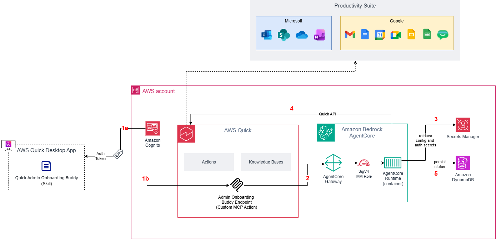

# AWS Quick Admin Buddy MCP

Setting up AWS Quick for an organization means creating an action connector or
a knowledge base for each productivity app, then sharing each one with the
right users. This Model Context Protocol (MCP) server does that setup from a
chat. An administrator talks to the Quick Admin Onboarding Buddy skill, and the
skill calls the server's tools to create, share, and delete those integrations
in your AWS Quick account.

The server's tools create two kinds of AWS Quick integrations:

- Action connectors, with [`CreateActionConnector`](https://docs.aws.amazon.com/quicksight/latest/APIReference/API_CreateActionConnector.html)
- Knowledge bases, with [`CreateKnowledgeBase`](https://docs.aws.amazon.com/quicksight/latest/APIReference/API_CreateKnowledgeBase.html)

Each integration authenticates with a custom OAuth app, service-to-service
OAuth, or an API key, and the credentials come from an AWS Secrets Manager
secret that the administrator names. When a parameter is missing, the tools
say which one and return the secret's JSON contract. When a `Create*` call
fails, they return the API error so the administrator can fix it.

The extension tools track the client-side AWS Quick extensions, the Office
add-ins and the browser extension. AWS Quick has no admin API for extensions,
so the status is one the administrator attests to.

The server runs on Amazon Bedrock AgentCore Runtime behind an AgentCore Gateway
that accepts only requests with a valid Amazon Cognito access token (OAuth 2.0
authorization code grant). It ships as a container image plus a single AWS
CloudFormation template.

## How it fits with the skill

This project is the backend of the official Quick Admin Onboarding Buddy skill
(catalog ID `admin-onboarding-buddy`), published in the
[AWS Quick official skill catalog](https://github.com/Amazon-Quick/Amazon-Quick-official-catalog/tree/main/skills/aws-quick/admin-onboarding-buddy).
The skill reaches the server through the Admin Onboarding Buddy Endpoint MCP
action connector, and it can't change anything in AWS Quick unless this backend
is deployed.

The skill walks an AWS Quick administrator through onboarding. It starts with
the productivity suite (Microsoft 365 or Google Workspace), then turns on action
connectors and knowledge bases, shares them with users, and tracks extensions.
The skill holds the conversation and the step-by-step guidance, and this
backend makes the AWS Quick admin API calls.

The skill bundles a copy of
[`infrastructure/template.yaml`](https://github.com/aws-samples/sample-amazon-quick-suite-knowledge-hub/blob/main/infrastructure/aws-quick-admin-buddy-mcp/infrastructure/template.yaml)
as `assets/template.yaml`, and this folder is the source for the container
image that the template deploys. To use the skill, deploy this backend, add it
to AWS Quick as an MCP action connector
([Step 3](#step-3-connect-the-server-to-aws-quick)), and then install the skill
from the official catalog.

## Architecture

The following diagram shows how a request from the skill reaches AWS Quick.
The step labels in the diagram match the table after it.



| Step | What happens |
| --- | --- |
| 1a | The administrator signs in through the Amazon Cognito hosted UI (OAuth 2.0 authorization code grant), and the Admin Onboarding Buddy Endpoint connector receives an access token. |
| 1b | The Quick Admin Onboarding Buddy skill, running in the AWS Quick desktop application, calls the backend's tools through the Admin Onboarding Buddy Endpoint, a custom MCP action connector in AWS Quick. The connector sends the access token with every call. |
| 2 | The AgentCore Gateway validates the token with its `CUSTOM_JWT` authorizer (the Cognito discovery URL and the allowed app client) and rejects requests without a valid token. It calls the AgentCore Runtime container with AWS Signature Version 4 (SigV4), using its own AWS Identity and Access Management (IAM) role. |
| 3 | The MCP server reads the integration's credentials from the AWS Secrets Manager secret that the administrator names. |
| 4 | The server calls the AWS Quick admin APIs as the `<stack-name>-Agent-IAM-Identity` role (the runtime role), which can call only the AWS Quick action-connector, knowledge-base, and data-source operations the server uses, in this account. These calls create, share, and delete action connectors and knowledge bases. AWS Quick then connects those integrations to the Microsoft 365 or Google Workspace productivity suite. |
| 5 | The server records each integration's status in the `OnboardingState` Amazon DynamoDB table, so the skill can resume and summarize the onboarding. |

The backend doesn't receive the end user's identity, so everyone who uses the
connector acts on one shared tenant. See
[Authentication and authorization model](docs/auth-model.md) for details.

## What gets created

One CloudFormation stack (`infrastructure/template.yaml`) creates the following
resources. Every resource that supports tags carries the tag
`Project=QuickAdminBuddy`, so you can track the stack's costs.

- An AgentCore Runtime that hosts the MCP server container (stateless
  streamable HTTP, port 8000, `linux/arm64`).
- An AgentCore Gateway and gateway target in front of the Runtime, with a
  Cognito `CUSTOM_JWT` inbound authorizer.
- An Amazon Cognito user pool that allows only administrator-created users. It
  comes with a resource server (`quick-admin-buddy/invoke` scope), a hosted-UI
  domain, and a confidential app client whose callback is the AWS Quick OAuth
  callback. Custom resources store the client secret and a generated sign-in
  user's credentials in Secrets Manager.
- IAM roles: the runtime role for the server's outbound calls, the gateway
  execution role, and roles for the AWS Lambda functions behind the custom
  resources.
- The `OnboardingState` DynamoDB table, retained when you delete the stack.
- An AWS Key Management Service (AWS KMS) customer managed key with rotation
  turned on, retained when you delete the stack. It encrypts the table, the
  stack's secrets, and the log groups.
- Amazon CloudWatch Logs log groups for the Runtime, Gateway, and
  workload-identity logs and for the Lambda functions, each with a 90-day
  retention period and retained when you delete the stack.
- A "Quick Setup Buddy" AWS Quick chat agent, optionally shared with the
  principals you pass in `QuickSetupBuddySharePrincipals`.

The stack doesn't create the AWS Quick MCP action connector, because custom
MCP connectors can't be created with CloudFormation. You create it by hand in
[Step 3](#step-3-connect-the-server-to-aws-quick).

## MCP tools

The server exposes the following tools.

| Tool | Purpose |
| --- | --- |
| `list_connector_catalog` | List the supported integrations and the configuration each one needs |
| `set_productivity_suite` | Record the tenant's productivity suite (Microsoft 365 or Google Workspace), which gates the catalog |
| `enable_action_connector` | Create an AWS Quick action connector |
| `disable_action_connector` | Delete an action connector the server created |
| `enable_kb_integration` | Create an AWS Quick knowledge base (and its data source) |
| `disable_kb_integration` | Delete a knowledge base the server created |
| `share_action_connector` | Share an action connector with AWS Quick users or groups |
| `share_kb_integration` | Share a knowledge base with AWS Quick users or groups |
| `get_tenant_configuration` | Return the tenant's recorded configuration |
| `get_onboarding_summary` | Summarize onboarding progress across connectors, knowledge bases, and extensions |
| `list_extensions` | List the AWS Quick extensions and their attested status |
| `set_extension_status` | Record the administrator-attested status of an extension |

Inputs, outputs, every `Result_Status` value, and the connector catalog are in
the [Tool reference](docs/tool-reference.md).

## Prerequisites

You need the following before you deploy:

- AWS Command Line Interface (AWS CLI) version 2, with credentials for the
  target account and Region and permission to create the resources in
  [What gets created](#what-gets-created) (CloudFormation, IAM, Cognito,
  DynamoDB, AWS KMS, Amazon Bedrock AgentCore, Lambda, Secrets Manager,
  CloudWatch Logs, Amazon Elastic Container Registry (Amazon ECR), and AWS
  Quick chat agents).
- Docker with `buildx`, to build a `linux/arm64` image.
- An AWS Quick account with an Enterprise subscription, where you are an
  administrator and can add MCP action connectors.
- Amazon Bedrock AgentCore available in the target Region.
- Python 3.12 or later, only to run the tests locally.

## Get the code

```bash
git clone https://github.com/aws-samples/sample-amazon-quick-suite-knowledge-hub.git
cd sample-amazon-quick-suite-knowledge-hub/infrastructure/aws-quick-admin-buddy-mcp
```

Run every command that follows from this folder.

## Step 1: Build and push the container image

AgentCore Runtime pulls the server image from Amazon ECR and runs on AWS
Graviton, so build for `linux/arm64`. A plain `docker build` on an x86_64 host
produces an amd64 image that the Runtime can't run.

```bash
export AWS_REGION=us-east-1
export ACCOUNT_ID=$(aws sts get-caller-identity --query Account --output text)
export ECR_REPO=quick-admin-buddy-mcp
export IMAGE_TAG=0.1.0
export IMAGE_URI="${ACCOUNT_ID}.dkr.ecr.${AWS_REGION}.amazonaws.com/${ECR_REPO}:${IMAGE_TAG}"

# 1. Create the ECR repository (first time only)
aws ecr create-repository \
  --repository-name "${ECR_REPO}" \
  --region "${AWS_REGION}" \
  --image-scanning-configuration scanOnPush=true

# 2. Authenticate Docker to ECR
aws ecr get-login-password --region "${AWS_REGION}" \
  | docker login --username AWS --password-stdin \
      "${ACCOUNT_ID}.dkr.ecr.${AWS_REGION}.amazonaws.com"

# 3. Build for the AgentCore Runtime architecture and push
docker buildx build --platform linux/arm64 -t "${IMAGE_URI}" --load .
docker push "${IMAGE_URI}"
```

The image is built from the project
[`Dockerfile`](https://github.com/aws-samples/sample-amazon-quick-suite-knowledge-hub/blob/main/infrastructure/aws-quick-admin-buddy-mcp/Dockerfile).
It uses Python 3.12, runs the server as an unprivileged user, and listens on
port 8000 inside the container. You don't need to run the container locally.
If you do, publish the port to loopback only (`docker run -p 127.0.0.1:8000:8000 ...`),
because the server has no authentication of its own; the Gateway provides it
in AWS.

## Step 2: Deploy the stack

The template is larger than the CloudFormation inline limit of 51,200 bytes, so
`aws cloudformation deploy` must stage it in an Amazon Simple Storage Service
(Amazon S3) bucket with `--s3-bucket`.

```bash
# 1. Reuse a bucket for CloudFormation templates, or create one (first time
#    only; bucket names are globally unique)
export TEMPLATE_BUCKET="cfn-deploy-${AWS_REGION}-${ACCOUNT_ID}"
aws s3 mb "s3://${TEMPLATE_BUCKET}" --region "${AWS_REGION}"

# 2. Deploy. --template-file is the local path; the CLI uploads it to the
#    bucket and prefix given by --s3-bucket and --s3-prefix.
aws cloudformation deploy \
  --region "${AWS_REGION}" \
  --stack-name quick-admin-buddy-mcp \
  --template-file infrastructure/template.yaml \
  --s3-bucket "${TEMPLATE_BUCKET}" \
  --s3-prefix quick-admin-buddy-mcp \
  --capabilities CAPABILITY_NAMED_IAM \
  --parameter-overrides \
      ContainerImageUri="${IMAGE_URI}" \
      CognitoDomainPrefix="${ACCOUNT_ID}-quickonboarding" \
      QuickSetupBuddySharePrincipals="arn:aws:quicksight:${AWS_REGION}:${ACCOUNT_ID}:user/default/<quick-user-name>"
```

- `CognitoDomainPrefix` (required) is a globally unique, lowercase prefix for
  the Cognito OAuth 2.0 endpoints.
- `QuickSetupBuddySharePrincipals` (optional) is a comma-separated list of AWS
  Quick user, group, or namespace Amazon Resource Names (ARNs) to share the
  "Quick Setup Buddy" chat agent with. Leave it out to keep the chat agent
  visible only to its creator.

The stack's resource names are fixed, so you can deploy one stack per account
and Region. The [Deployment guide](docs/deployment-guide.md) lists every
parameter and output.

## Step 3: Connect the server to AWS Quick

Create an MCP action connector in AWS Quick that points at the Gateway. First,
read the values from the stack outputs:

```bash
aws cloudformation describe-stacks \
  --region "${AWS_REGION}" \
  --stack-name quick-admin-buddy-mcp \
  --query "Stacks[0].Outputs"
```

Then follow these steps, from
[Set up MCP integration](https://docs.aws.amazon.com/quick/latest/userguide/mcp-integration.html#mcp-integration-setup):

1. In the AWS Quick console, choose **Connectors**, choose the **Create for
   your team** tab, and then choose **Model Context Protocol (MCP)**.
1. For **Name**, enter the `ActionConnectorSuggestedName` output. For **MCP
   server endpoint**, enter the `ActionConnectorBaseEndpoint` output unchanged;
   it already ends in `/mcp`. For **Connection type**, choose **Public
   network**. Then choose **Next**.
1. Choose **User authentication (OAuth)**, and enter **Client ID**
   (`CognitoUserPoolClientId`), **Client Secret** (from the secret in
   `CognitoClientSecretArn`), **Token URL** (`CognitoTokenEndpoint`),
   **Authorization URL** (`CognitoAuthorizationEndpoint`), and **Redirect URL**
   (`ActionConnectorRedirectUrl`).
1. Choose **Create and continue**, review the integration, and choose **Next**.

When AWS Quick asks you to sign in, use the Cognito user in `CognitoUsername`.
Its password is in the Secrets Manager secret in
`CognitoUserCredentialsSecretArn`. The
[Deployment guide](docs/deployment-guide.md) has the commands to read both
secrets and explains how to give other AWS Quick users access to the
connector.

After the connector is created, install the Quick Admin Onboarding Buddy skill
in the AWS Quick desktop application and start the onboarding conversation.

## Update the stack with a change set

To ship a new build, push a new `IMAGE_TAG` and run the Step 2 command again
with the new `ContainerImageUri`. After a container update, refresh the
Gateway's tool list as described in the
[Deployment guide](docs/deployment-guide.md). Then open the connector's details
page in AWS Quick, choose **Sync**, and sign in again when AWS Quick asks. AWS
Quick doesn't pick up new or renamed tools on a custom MCP connector until its
owner syncs it.

Use an explicit change set instead when you want to review what will change
(replacements, deletions, IAM changes) before anything is applied:

```bash
export STACK_NAME=quick-admin-buddy-mcp
export CHANGE_SET_NAME="update-$(date +%Y%m%d%H%M%S)"

# 0. The raw create-change-set API caps an inline template at 51,200 bytes, so
#    upload the template to S3 and reference it with --template-url.
aws s3 cp infrastructure/template.yaml \
  "s3://${TEMPLATE_BUCKET}/quick-admin-buddy-mcp/template.yaml" \
  --region "${AWS_REGION}"
export TEMPLATE_URL="https://${TEMPLATE_BUCKET}.s3.${AWS_REGION}.amazonaws.com/quick-admin-buddy-mcp/template.yaml"

# 1. Create the change set (does not modify the stack)
aws cloudformation create-change-set \
  --region "${AWS_REGION}" \
  --stack-name "${STACK_NAME}" \
  --change-set-name "${CHANGE_SET_NAME}" \
  --change-set-type UPDATE \
  --template-url "${TEMPLATE_URL}" \
  --capabilities CAPABILITY_NAMED_IAM \
  --parameters \
      ParameterKey=ContainerImageUri,ParameterValue="${ACCOUNT_ID}.dkr.ecr.${AWS_REGION}.amazonaws.com/quick-admin-buddy-mcp:NEW_TAG" \
      ParameterKey=CognitoDomainPrefix,UsePreviousValue=true \
      ParameterKey=OnboardingStateTableName,UsePreviousValue=true \
      ParameterKey=ActionConnectorName,UsePreviousValue=true \
      ParameterKey=TenantId,UsePreviousValue=true \
      ParameterKey=QuickSetupBuddyAgentId,UsePreviousValue=true \
      ParameterKey=QuickSetupBuddySharePrincipals,UsePreviousValue=true

# 2. Wait for the diff, then review it
aws cloudformation wait change-set-create-complete \
  --region "${AWS_REGION}" --stack-name "${STACK_NAME}" --change-set-name "${CHANGE_SET_NAME}"
aws cloudformation describe-change-set \
  --region "${AWS_REGION}" --stack-name "${STACK_NAME}" --change-set-name "${CHANGE_SET_NAME}"

# 3. Execute it after the diff looks correct, and wait for the update
aws cloudformation execute-change-set \
  --region "${AWS_REGION}" --stack-name "${STACK_NAME}" --change-set-name "${CHANGE_SET_NAME}"
aws cloudformation wait stack-update-complete \
  --region "${AWS_REGION}" --stack-name "${STACK_NAME}"
```

- Keep `UsePreviousValue=true` for every parameter you are not changing.
  Otherwise CloudFormation resets it to the template default.
- If the change set reports `didn't contain changes`, there is nothing to
  update. Delete it with `delete-change-set`.
- Don't execute a change set that shows `Replacement: True` on a stateful
  resource such as the DynamoDB table or the Cognito user pool. Replacement
  deletes and recreates the resource.

## Development

```bash
python3 -m venv .venv
source .venv/bin/activate
pip install -e ".[dev]"
pytest
cfn-lint infrastructure/template.yaml
```

The tests are unit tests plus Hypothesis property-based tests. They run at a
minimum of 100 Hypothesis examples through the `quick_admin_buddy` profile in
`tests/conftest.py`. DynamoDB tests use `moto`, so no AWS account is needed.

At startup the server writes one JSON log line with the settings it read from
its environment (see
[Stack parameters](docs/deployment-guide.md#stack-parameters)), and stops with an error
that names the variable if a value is invalid. Each tool call then writes one
JSON log line (tool name, connector or extension key, result status, AWS
request IDs, and duration, with no arguments or secret values) to the Runtime's
CloudWatch Logs log group.

## Cleanup

```bash
aws cloudformation delete-stack --region "${AWS_REGION}" --stack-name quick-admin-buddy-mcp
```

The following resources are retained or live outside the stack, and you remove
them yourself:

- The AWS Quick MCP action connector you created in Step 3.
- Any action connectors and knowledge bases the server created in AWS Quick.
  Turn them off with the `disable_*` tools before you delete the stack, or
  delete them in the console.
- The DynamoDB table, the AWS KMS key, and the CloudWatch Logs log groups,
  which the template retains (`DeletionPolicy: Retain`).
- The Amazon ECR repository and the template bucket.

The [Deployment guide](docs/deployment-guide.md) lists the retained resources
in detail and explains how to redeploy into the same account afterwards.

## Security

The sample controls access as follows:

- Inbound requests need a valid Cognito access token, which the Gateway's
  `CUSTOM_JWT` authorizer checks. The Cognito user pool allows only users that
  an administrator creates, and the app client issues tokens only through the
  hosted-UI authorization code grant.
- The Runtime accepts only requests signed with AWS Signature Version 4 by an
  IAM principal allowed to call `InvokeAgentRuntime`, and the container
  publishes no port.
- The runtime role can call only the AWS Quick operations the server uses, in
  this account, and can read only Secrets Manager secrets whose names start
  with `quick-admin-buddy/`.
- The tools accept credentials only by Secrets Manager secret name. A secret
  value passed as a tool argument is rejected, so credentials don't pass
  through the chat.
- The Cognito client secret, the sign-in user's password, and the integration
  credentials are in Secrets Manager, encrypted with the stack's AWS KMS key.
  Stack outputs contain secret ARNs, not secret values. This repository
  contains no credentials.
- The caller's identity isn't passed to the backend, so everyone who can use
  the connector acts on the same AWS Quick account. The skill is meant for
  account setup, when only the administrator uses it; share the connector only
  with the administrators who should onboard the account.

This sample uses Amazon Cognito so that it works without an existing identity
provider. In your own deployment you can point the Gateway's `CUSTOM_JWT`
authorizer at the OpenID Connect (OIDC) identity provider your organization
already uses. See [Authentication and authorization model](docs/auth-model.md)
for the full model.

## Repository layout

```text
aws-quick-admin-buddy-mcp/
├── src/quick_admin_buddy_mcp/
│   ├── server.py              # MCP entry point: tool registrations, streamable HTTP
│   ├── config.py              # Settings read from environment variables at startup
│   ├── observability.py       # Startup and per-tool-call structured log lines
│   ├── domain/                # Catalog, request models, validation, Tool_Result
│   │   └── operations/        # One class per onboarding operation (MCP tool)
│   ├── quick/                 # AWS Quick admin API client (boto3), Secrets Manager
│   └── state/                 # Onboarding state persistence (in memory and DynamoDB)
├── infrastructure/
│   └── template.yaml          # Single CloudFormation template for the whole backend
├── docs/
│   ├── tool-reference.md      # Tool inputs, outputs, Result_Status values, catalogs
│   ├── deployment-guide.md    # Parameters, outputs, connector setup, updates, teardown
│   └── auth-model.md          # Inbound, gateway-to-runtime, and outbound auth
├── tests/                     # Unit, property-based, and moto integration tests
├── images/                    # Architecture diagram used in this README
├── Dockerfile                 # linux/arm64 image for AgentCore Runtime
└── pyproject.toml             # Package metadata, pinned dependencies, pytest and ruff config
```

## Contributing

See [How to Contribute](https://aws-samples.github.io/sample-amazon-quick-suite-knowledge-hub/HOW-TO-CONTRIBUTE/).

## License

This library is licensed under the MIT-0 License. See the [LICENSE](/LICENSE)
file.
