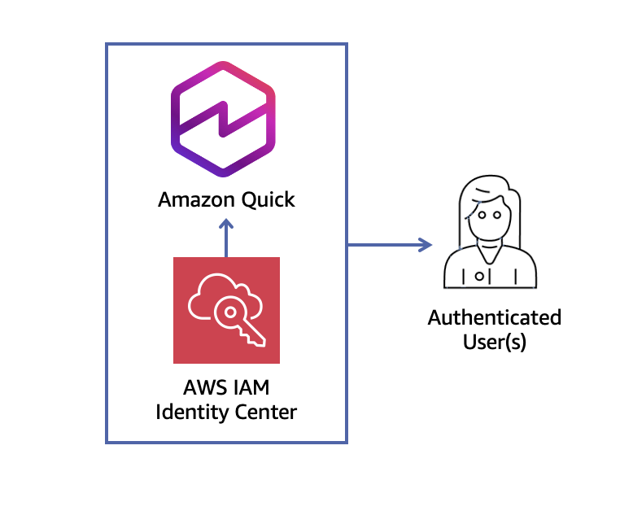

# Amazon Quick Bootstrap - Terraform

This Terraform project sets up Amazon Quick. It ships in two layers:

- **Modular blueprints** (recommended) - pick a blueprint, fill a `.tfvars`, and deploy.
  Each blueprint composes small reusable modules via feature flags, so you choose VPC
  vs non-VPC, IDC vs non-IDC, KMS, custom permissions, and more.
- **Legacy root module** (preserved for backward compatibility) - the original
  Lambda-based bootstrap at the project root (`main.tf`, `variables.tf`, `outputs.tf`).
  Existing state keeps working; see [Legacy root module](#legacy-root-module).

## Choose a blueprint

| Blueprint | IDC | VPC | KMS | Custom permissions | Use when |
| --- | --- | --- | --- | --- | --- |
| [`minimal`](blueprints/minimal) | ✗ | ✗ | ✗ | ✗ | Quick evaluation account, native QuickSight identity |
| [`idc-centralized`](blueprints/idc-centralized) | ✓ | ✗ | ✓ | ✓ | Recommended centralized enterprise setup |
| [`vpc-no-idc`](blueprints/vpc-no-idc) | ✗ | ✓ | ✓ | ✗ | Network-isolated Quick without Identity Center |
| [`idc-vpc-governed`](blueprints/idc-vpc-governed) | ✓ | ✓ | ✓ | ✓ | Full governance; every capability is a flag |
| [`locked-down`](blueprints/locked-down) | ✓* | ✗ | ✓ | ✓ (deny-by-default) | Secure-by-default: readers view-only, authors cannot share, out of the box |

`idc-vpc-governed` is the superset: the other three are thin presets over it (or over the
modules directly), so turning its flags off reproduces the simpler topologies.

### Deploy a blueprint

```bash
cd blueprints/idc-centralized
cp terraform.tfvars.example terraform.tfvars   # edit values
terraform init
terraform plan
terraform apply
```

## Reusable modules

Under `modules/`, each is self-contained and independently composable:

| Module | Purpose | Key toggles |
| --- | --- | --- |
| `quick-account` | Account subscription + namespace (native `aws_quicksight_account_subscription`) | `authentication_method` (IDC vs `IAM_AND_QUICKSIGHT`), `create_namespace` |
| `identity-center` | Create or reference IDC groups | per-group `create` |
| `service-roles` | QuickSight service role (Athena/S3 data access) | `attach_athena_access`, `s3_bucket_arns` |
| `kms` | CMK + QuickSight key registration, IDC-aware key policy | `multi_region`, `allow_identity_center` |
| `vpc-access` | Type 1 PrivateLink endpoint + Type 2 QuickSight VPC connection | `enable_privatelink`, `enable_vpc_connection` |
| `custom-permissions` | Custom-permission profiles + role binding | `use_cloudformation` (fallback) |
| `account-governance` | Account settings, IP/VPC restrictions, IAM policy assignments | `enable_account_settings`, `enable_ip_restriction` |

### Custom permissions: deny-by-default, presets, and raw control

The `custom-permissions` module models the full QuickSight capability surface (20
capabilities) with three ergonomic layers, so you rarely hand-list flags. Each profile
accepts:

- `deny_by_default = true` - start from **deny everything**, then carve exceptions back
  with `allow = [...]` (an allowlist). This is the secure-by-default inversion.
- `preset = "<name>"` - apply a ready-made posture. Built-in presets:
  - `reader_lockdown` - deny all authoring, sharing, and dataset/data-source creation
  - `no_data_exfiltration` - deny every export path (csv/excel/pdf), print, and data sharing
  - `author_no_share` - can build, cannot share externally
  - `strict_pro` - pro role with sharing and export denied
- `capabilities = { export_to_csv = "DENY" }` - raw escape hatch for individual flags.

Precedence (most specific wins): `capabilities` > `allow` > `preset` > `deny_by_default`
base. Example:

```hcl
custom_permission_profiles = {
  LockedReader = { deny_by_default = true, allow = ["export_to_pdf"] } # view + PDF only
  NoExfil      = { preset = "no_data_exfiltration" }
}
custom_permission_role_assignments = {
  READER = "LockedReader"
  AUTHOR = "NoExfil"
}
```

Semantics: QuickSight expresses a capability as DENY or unset (unset = account default =
permitted). "allow" means "leave unset" (not denied); it does not grant beyond the
account default. The `locked-down` blueprint ships this hardened out of the box.

### Account governance: settings, IP restrictions, IAM policy assignments

The `account-governance` module adds account-wide admin controls, each behind its own
toggle, wired into the `idc-vpc-governed` superset:

- **Account settings** (`enable_account_settings`) - set the `default_namespace` and
  `termination_protection_enabled` so the Amazon Quick subscription cannot be deleted
  accidentally.
- **IP / VPC restrictions** (`enable_ip_restriction`) - gate console and API access to an
  allowlist. Supply any of `ip_restriction_rule_map` (CIDR => description),
  `vpc_id_restriction_rule_map`, or `vpc_endpoint_id_restriction_rule_map`. The
  `ip_restriction_enabled` flag enforces (or just stages) the rules.
- **IAM policy assignments** (`iam_policy_assignments`) - bind an IAM managed policy to
  QuickSight users/groups within a namespace, with `status` ENABLED/DISABLED/DRAFT.

```hcl
enable_account_settings        = true
termination_protection_enabled = true

enable_ip_restriction  = true
ip_restriction_enabled = true
ip_restriction_rule_map = { "203.0.113.0/24" = "Corp egress NAT" }

iam_policy_assignments = {
  AnalystBaseline = {
    policy_arn = "arn:aws:iam::aws:policy/AWSQuicksightAthenaAccess"
    groups     = ["QUICK_ADMIN"]
  }
}
```

### Terraform-native, with CloudFormation fallback

Capabilities use first-class AWS provider resources where available
(`aws_quicksight_account_subscription`, `aws_quicksight_namespace`,
`aws_quicksight_custom_permissions`, `aws_quicksight_role_custom_permission`,
`aws_quicksight_vpc_connection`, `aws_quicksight_key_registration`, `aws_vpc_endpoint`,
`aws_kms_key`, `aws_identitystore_group`, `aws_quicksight_account_settings`,
`aws_quicksight_ip_restriction`, `aws_quicksight_iam_policy_assignment`). Where a resource is not yet in the provider,
the module falls back to a CloudFormation stack (e.g. `custom-permissions` with
`use_cloudformation = true` uses `AWS::QuickSight::CustomPermissions`).

## Legacy features

- Creates or uses existing IAM Identity Center instance
- Sets up Quick Sight account subscription
- Creates admin group in Identity Center
- Configures necessary IAM roles and policies
- Deploys Lambda function for automated setup

## Legacy root module

> The commands below deploy the original Lambda-based bootstrap from the project
> root. It is preserved for backward compatibility; new deployments should prefer a
> [blueprint](#choose-a-blueprint).

### Prerequisites

- AWS CLI configured with appropriate credentials
- Terraform >= 1.0.0
- Python 3.12 (for Lambda function)
- pip (for installing Lambda dependencies)

## Quick Start

1. **Clone and navigate to the module:**

   ```bash
   cd terraform/quick-suite-bootstrap
   ```

2. **Create your variables file:**

   ```bash
   cp terraform.tfvars.example terraform.tfvars
   ```

3. **Edit `terraform.tfvars` with your values:**

   ```hcl
   aws_region                   = "us-east-1"
   quick_suite_account_name     = "MyQuickSuite"
   quick_suite_admin_email      = "admin@mycompany.com"
   quick_suite_admin_group_name = "QuickSuiteAdmins"
   ```

4. **Initialize Terraform:**

   ```bash
   terraform init
   ```

5. **Review the plan:**

   ```bash
   terraform plan
   ```

6. **Apply the configuration:**

   ```bash
   terraform apply
   ```

## Variables

| Name | Description | Type | Default | Required |
| --- | --- | --- | --- | --- |
| `aws_region` | AWS region to deploy resources | `string` | `"us-east-1"` | No |
| `identity_center_instance_arn` | ARN of existing IAM Identity Center instance | `string` | `""` | No |
| `quick_suite_account_name` | Name for the Quick account | `string` | `"QuickSuiteBootstrap"` | No |
| `quick_suite_admin_email` | Email address for the Quick admin | `string` | `"admin@example.com"` | No |
| `quick_suite_admin_group_name` | Name of the admin group in Identity Center | `string` | `"QUICK_SUITE_ADMIN"` | No |
| `force_update` | Set to true to force re-run of setup | `bool` | `false` | No |
| `tags` | Additional tags to apply to resources | `map(string)` | `{}` | No |

## Outputs

| Name | Description |
| --- | --- |
| `identity_center_instance_arn` | ARN of the IAM Identity Center instance |
| `identity_store_id` | ID of the Identity Store |
| `lambda_function_arn` | ARN of the Quick setup Lambda function |
| `lambda_function_name` | Name of the Lambda function |
| `lambda_execution_role_arn` | ARN of the Lambda execution role |
| `quick_suite_account_name` | Name of the Quick account |
| `quick_suite_admin_email` | Admin email for Quick |
| `quick_suite_admin_group_name` | Admin group name in Identity Center |

## Architecture



## Using with Existing Identity Center

If you already have an IAM Identity Center instance, provide its ARN:

```hcl
identity_center_instance_arn = "arn:aws:sso:::instance/ssoins-1234567890abcdef"
```

## Force Re-run Setup

To force the Lambda to re-run the setup (e.g., after configuration changes):

```bash
terraform apply -var="force_update=true"
```

## Cleanup

To destroy all resources:

```bash
terraform destroy
```

**Note:** This will attempt to delete the Quick Sight subscription and related resources.

## Troubleshooting

### Lambda Build Fails

Ensure Python 3.12 and pip are installed:

```bash
python3 --version
pip3 --version
```

### Permission Errors

The Lambda function requires extensive permissions. Ensure your AWS credentials have sufficient privileges to create IAM roles and policies.

### Identity Center Issues

If using an existing Identity Center, ensure the ARN is correct and your credentials have access to it.

## License

This project is licensed under the [MIT-0 (MIT No Attribution)](https://github.com/aws-samples/sample-amazon-quick-suite-knowledge-hub/blob/main/LICENSE) license.

## Related Resources

- [Amazon Quick Documentation](https://docs.aws.amazon.com/quick/latest/userguide/)
- [IAM Identity Center Documentation](https://docs.aws.amazon.com/singlesignon/)
- [Terraform AWS Provider](https://registry.terraform.io/providers/hashicorp/aws/latest/docs)
