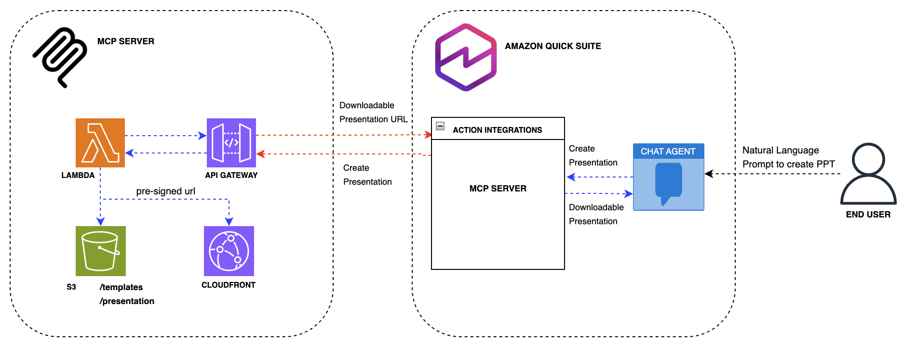
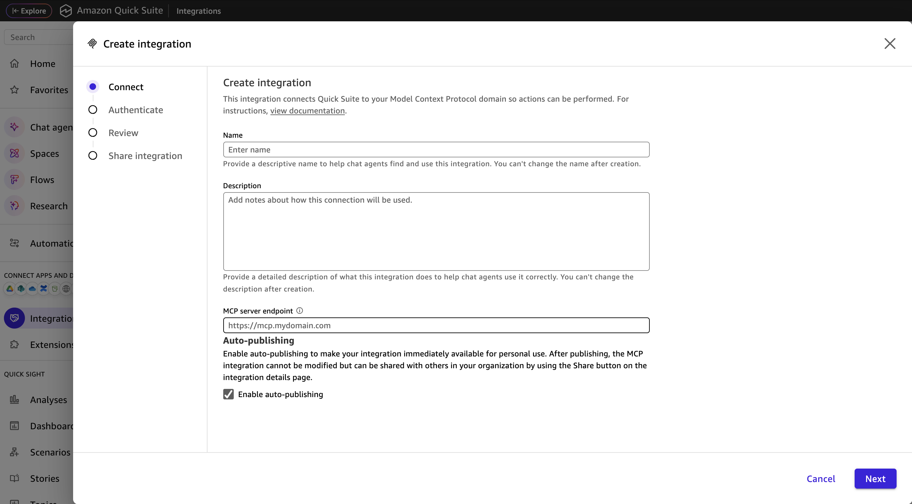
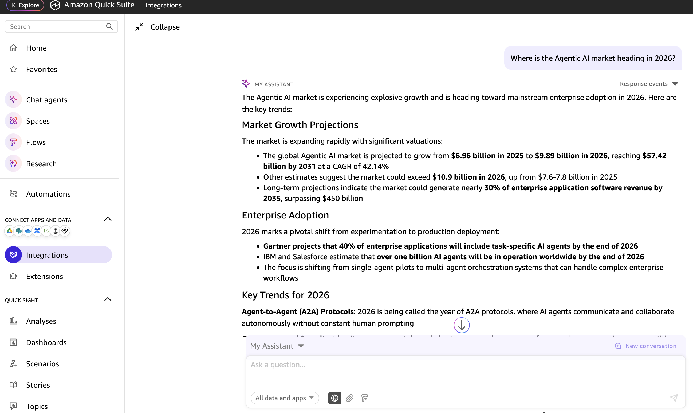
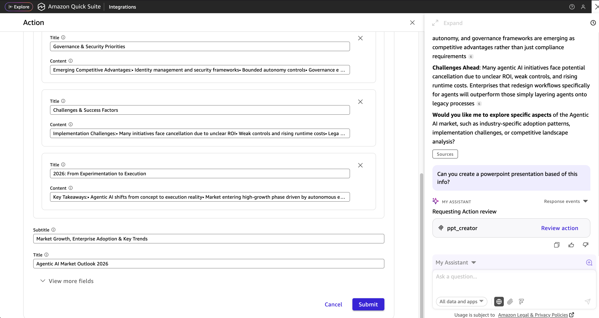
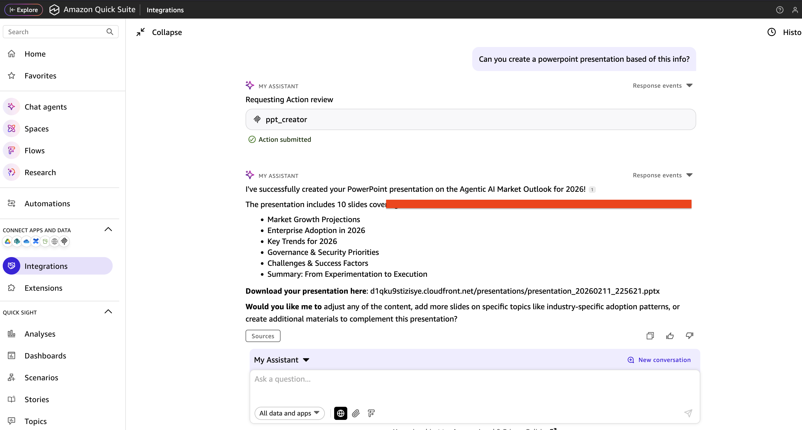

# Build Custom MCP Server Integration with Amazon Quick to create Power Point Presentations

This guide demonstrates how to build a custom Model Context Protocol (MCP) server integration that enables Amazon Quick to generate PowerPoint presentations directly from chat conversations. By creating this integration, users can leverage Quick AI capabilities to transform their ideas, data, and content into professional presentations without leaving their workflow. The MCP server acts as a bridge between the Quick conversational interface and PowerPoint generation functionality, allowing users to simply describe their presentation needs in natural language and receive fully-formatted slides complete with titles, content, and structured layouts. This integration showcases the extensibility of the Amazon Quick platform and provides a practical template for building custom actions that enhance workplace productivity.

## Architecture Overview

This MCP (Model Context Protocol) server integration leverages a serverless architecture on AWS to enable PowerPoint presentation generation from the Amazon Quick chat interface. The solution is designed for scalability, reliability, and seamless integration with the Quick action framework.
Components

## AWS Lambda Function

    - Core processing engine that handles presentation generation requests
    - Utilizes Lambda Layers for shared dependencies and PowerPoint manipulation libraries
    - Processes incoming requests from Quick and orchestrates the presentation creation workflow
    - Executes business logic to transform user input into structured slide content

## Amazon API Gateway

    - Serves as the RESTful API endpoint for the MCP server
    - Provides secure, scalable access to the Lambda function
    - Handles request validation and routing from Quick to the backend
    - Requires an OAuth 2.0 access token (Amazon Cognito authorizer with the `ppt-creator/invoke` scope) on every request
    - Applies request throttling to the MCP endpoint

## Amazon Cognito

    - Issues OAuth 2.0 access tokens to Amazon Quick using the client credentials flow
    - Provides the client ID, client secret, and token URL used for Quick service authentication

## Amazon S3

    - Stores PowerPoint templates used as base files for presentation generation
    - Hosts generated presentation files (.pptx) after creation
    - Provides durable, scalable storage for both input templates and output artifacts
    - Private bucket: public access blocked, server-side encryption, TLS-only bucket policy
    - Stores each presentation under a random, unguessable key and deletes it after a retention period (default 7 days)
    - Delivers generated presentations via short-lived S3 pre-signed URLs (default 1 hour)

## Integration Flow

    1. User initiates a presentation request through Amazon Quick chat
    2. Quick obtains an OAuth 2.0 access token from Amazon Cognito and invokes the MCP server action via API Gateway
    3. API Gateway validates the access token and scope, then invokes the Lambda function with the presentation parameters (title, content, slides)
    4. Lambda retrieves the template from the `templates/` prefix in S3
    5. Lambda generates the PowerPoint presentation using the template and user-provided content
    6. Generated presentation is stored in S3 under a random key
    7. A short-lived S3 pre-signed URL is created for the presentation
    8. URL is returned to Quick and displayed to the user in the chat interface

This architecture ensures a responsive, scalable solution that integrates seamlessly with the Amazon Quick conversational AI capabilities while maintaining security and performance standards.

## Deployment Guide

## Prerequisites

- AWS CLI configured with appropriate credentials
- Terraform >= 1.0
- Python 3.11
- pip

## Quick Start

1. **Clone the repository**

    git clone <https://github.com/aws-samples/sample-amazon-quick-suite-knowledge-hub.git>
    cd docs/integration/actions/MCP/powerpoint-creator-mcp

2. **Configure variables (optional)**

    export TF_VAR_aws_region="us-west-2"
    export TF_VAR_presigned_url_expiry_seconds=3600   # download link lifetime (60-43200)
    export TF_VAR_presentation_retention_days=7       # days before generated decks are deleted
    export TF_VAR_access_token_validity_minutes=60    # OAuth access token lifetime

3. **Deploy with Terraform**

    terraform init
    terraform apply

4. **Note the outputs**
   After deployment, save these values:
   - `api_gateway_url` - MCP server endpoint
   - `cognito_token_url` - OAuth 2.0 token URL
   - `cognito_client_id` - OAuth 2.0 client ID
   - `cognito_client_secret` - OAuth 2.0 client secret (sensitive, read it with `terraform output -raw cognito_client_secret`)
   - `s3_bucket_name` - Storage bucket

    Treat the client secret as a credential. Do not commit it or share it in chat, and keep the Terraform state file secure because it contains the secret.

## Custom Template (optional)

Place your PowerPoint template at `templates/template.pptx`. Additional templates can be uploaded to the S3 bucket under the `templates/` prefix (for example `templates/brand/v2.pptx`) and selected with the `template_key` tool argument. Only keys under `templates/` that end in `.pptx` are accepted. The template should have:

- A title slide (layout 0) with title and subtitle placeholders
- A content slide layout (layout 1) for additional slides

## MCP Server Integration

1. Go to Amazon Quick --> Integrations --> Actions --> Model Context Protocol

    

2. Enter a name, description and api_gateway_url from terraform output to MCP server endpoint and click Next

3. Select **Service authentication** and enter the `cognito_client_id`, `cognito_client_secret` and `cognito_token_url` values from the Terraform outputs, then click Next

4. Click Next and Finish

## Testing

1. Ask any question to the Chat Agent in Amazon Quick. Ex: "Where is the Agentic AI market heading in 2026?"

2. Ask the Chat Agent to create a powerpoint presentation based on the output from previous prompt. Review the information in the pop up window and submit.

3. Quick will respond with a downloadable link to the created presentation. Copy and paste in a browser to download. The link is a pre-signed URL that expires after `presigned_url_expiry_seconds` (default 1 hour); ask Quick to create the presentation again if it has expired.

## Unit Tests

    uv run --no-project --python 3.11 --with pytest --with "moto[s3]" --with boto3 --with python-pptx pytest tests

## Security

- The MCP endpoint rejects requests without a valid Amazon Cognito access token that has the `ppt-creator/invoke` scope.
- Generated presentations are never publicly readable. They are only downloadable through a time-limited pre-signed URL, stored under random keys, and deleted after the retention period.
- The Lambda function can only read `templates/*` and read/write `presentations/*`, and the `template_key` argument is restricted to `templates/*.pptx`.
- Request payloads, tokens and download URLs are not written to CloudWatch Logs.

## Upgrading from a previous version

Earlier versions of this sample exposed the MCP endpoint without authentication and served generated presentations through a public CloudFront distribution. Running `terraform apply` with this version:

- Removes the CloudFront distribution, so previously issued CloudFront download links stop working.
- Requires updating the Amazon Quick MCP integration to use **Service authentication** with the new Cognito outputs. Requests without a token will receive `401 Unauthorized`.
- Applies the retention lifecycle rule, which deletes existing objects under `presentations/` that are older than `presentation_retention_days`.

## Cleanup

    terraform destroy

Note: This will delete all generated presentations in S3.

## License

This project is licensed under the MIT License - see the [LICENSE](https://github.com/aws-samples/sample-amazon-quick-suite-knowledge-hub/blob/main/LICENSE) file for details.

## Authors and Acknowledgment

- **Primary Developer**: Leo Mentis
- **AWS Services**: Amazon Quick, AWS Lambda, Amazon S3, Amazon API Gateway, Amazon Cognito
- **Protocol**: Model Context Protocol (MCP) specification
