# Databricks Unity Catalog (3LO) - Data Source Setup Guide

<!-- markdownlint-disable MD033 MD046 -- MkDocs admonitions (!!!) and the qh-compact wrapper -->

<div class="qh-compact" markdown>

This guide walks through connecting Amazon Quick to Databricks Unity Catalog with three-legged OAuth (3LO), end to end.

With 3LO, each Quick user signs in with their own Databricks identity, so Unity Catalog permissions (table access, row filters, column masks) are enforced per user.

It complements the official [Amazon Quick documentation for Databricks 3LO](https://docs.aws.amazon.com/quick/latest/userguide/catalog-integration-databricks-3lo.html).

Once the data source is created, you can use Databricks Unity Catalog in **two ways** (see Part 5):

- **Agentic mode**: explore your Unity Catalog through a conversation, with the **Explore data** button
- **Dataset source**: create datasets from the data source, then build topics and dashboards

**Prerequisites**:

- Databricks **account admin** access to the account console (`https://accounts.cloud.databricks.com`)
- A Databricks workspace with Unity Catalog enabled and a running SQL warehouse
- Amazon Quick **administrator** access (to add an OAuth client application)
- The AWS Region of your Amazon Quick account (used in the redirect URL, for example `us-west-2`)

!!! warning "DirectQuery only"

    Identity enforcement works only for **DirectQuery** datasets. If a dataset is switched to SPICE or has transformations applied, identity enforcement does not apply.

!!! info "Placeholders used in this guide"

    Replace them with your own values before you paste.

    - `<your-account-id>`: your **Databricks account ID** (Part 1, step 1)
    - `<region>`: the AWS Region of your Amazon Quick account, for example `us-west-2`

## Part 1 - Create the OAuth app connection in Databricks

**1)** Log in to the Databricks account console at <https://accounts.cloud.databricks.com>

Copy your **Databricks account ID** from the account menu (top right, your user name).

You will need it for the federation policy and for the token and authorization URLs.

**2)** From the left navigation menu, go to **Settings** → **App connections** → **Custom apps**, then choose **Add connection**

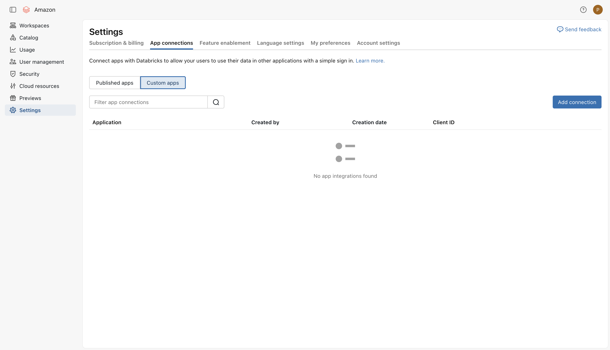

**3)** On the **Add connection** page, enter the following information:

**Application Name**:

```text
Amazon Quick
```

**Redirect URLs**:

```text
https://<region>.quicksight.aws.amazon.com/sn/oauthcallback
```

For example, for an Amazon Quick account in `us-west-2`:

```text
https://us-west-2.quicksight.aws.amazon.com/sn/oauthcallback
```

!!! note

    The Region in the redirect URL must match the Region of your Amazon Quick account.

**4)** In **Access scopes**, choose **Add scope**, search for `all-apis` and select it

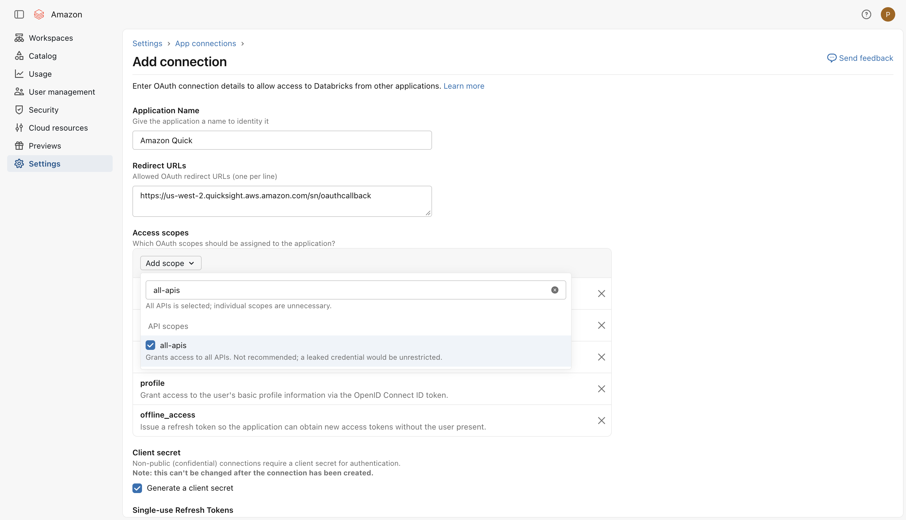

!!! note

    Selecting `all-apis` replaces the default `sql` scope, because `all-apis` already covers it.

Keep the other scopes present by default. Your scopes should look like this:

- `all-apis`
- `openid`
- `email`
- `profile`
- `offline_access`

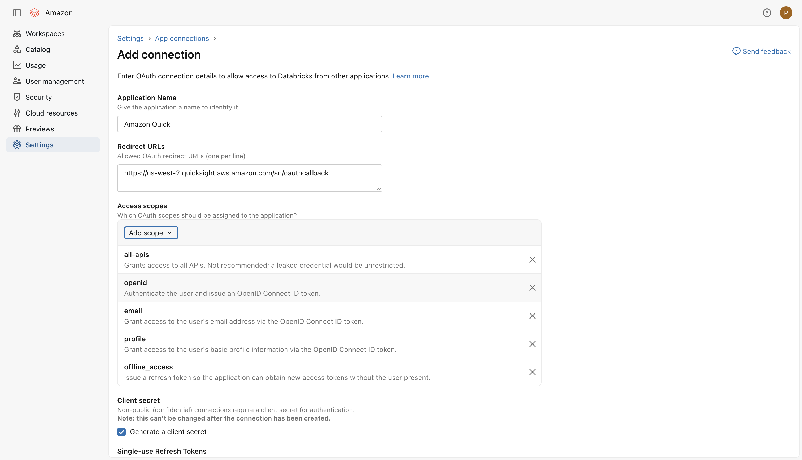

**5)** Leave everything else to its default value:

- **Client secret**: `Generate a client secret` checked
- **Single-use Refresh Tokens**: unchecked
- **Access token TTL (in minutes)**: `60`
- **Refresh token TTL (in minutes)**: `10080`

Then choose **Add**

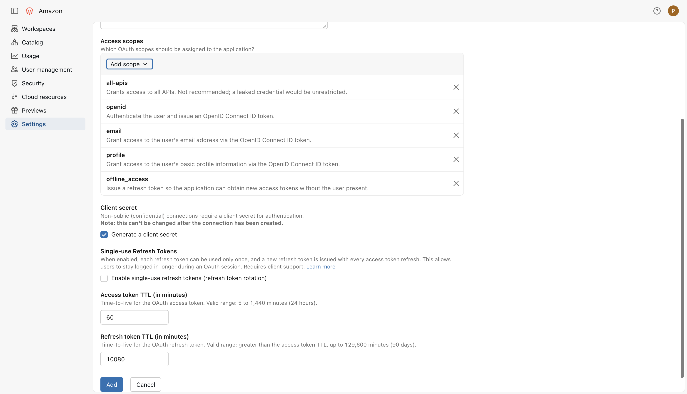

**6)** Get the **Client ID** and **Client secret**

After you choose **Add**, Databricks displays the **Client ID** and **Client secret** of the new connection.

Copy both values and store them securely.

!!! warning "Save the client secret now"

    The client secret is displayed only once. If you lose it, you have to create a new secret for the connection.

## Part 2 - Create the workload identity federation policy in Databricks

With **Trusted Identity Propagation**, Amazon Quick presents to Databricks the OIDC token issued by your **Databricks account** during the 3LO sign-in.

Databricks only accepts this token if a federation policy trusts your Databricks account as issuer.

Without this policy, the connection fails with a federation policy error. The error message lists the exact issuer and audience the policy must contain.

**1)** In the Databricks account console, go to **Security** → **Identity provider setup**

Under **Federation policies** → **Workload identity federation**, choose **Create policy**

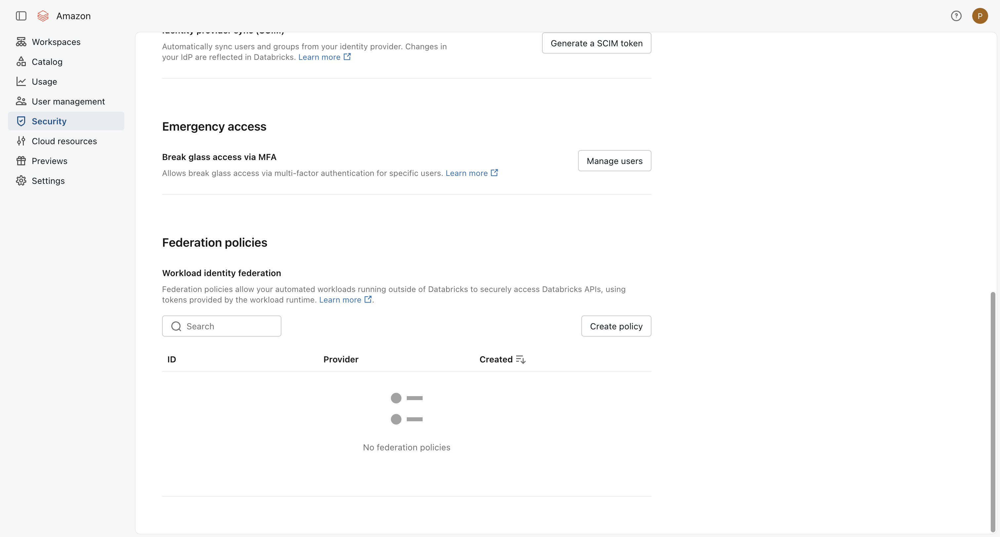

**2)** Insert the following data, where `<your-account-id>` is your **Databricks account ID** (from Part 1, step 1):

**Issuer URL**:

```text
https://accounts.cloud.databricks.com/oidc/accounts/<your-account-id>
```

**Audiences**:

```text
<your-account-id>
```

**Subject claim**: leave empty (default `sub`)

**Advanced fields** → **Token signature validation**: `Issuer (recommended)` (default)

Your configuration should look like this:

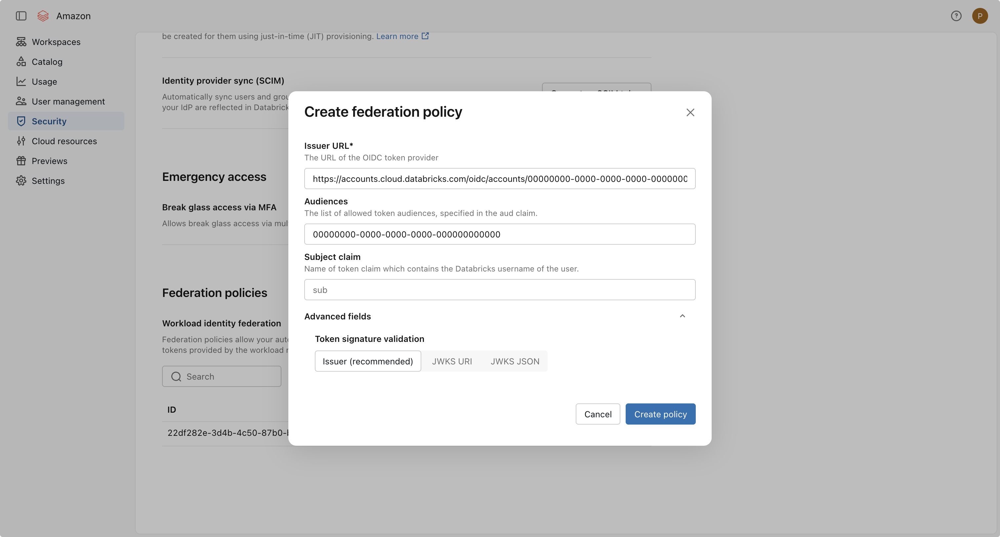

!!! note

    In the screenshot, the account ID is replaced by `00000000-0000-0000-0000-000000000000`. Use your own Databricks account ID.

    The issuer is the same Databricks account OIDC endpoint used for the token and authorization URLs in Part 3, without the `/v1/token` or `/v1/authorize` suffix.

**3)** Choose **Create policy**

## Part 3 - Add the OAuth client application in Amazon Quick

**1)** In the Amazon Quick console, choose your profile → **Manage account**

Under **Security**, choose **Manage OAuth Client Applications**, then choose **Add OAuth Client Application**

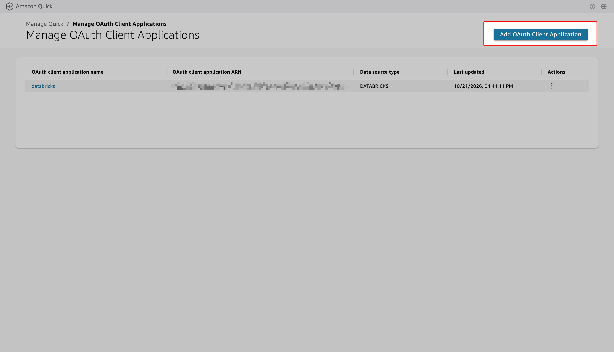

**2)** Insert the following data:

**Config ID**: a unique identifier, for example:

```text
databricks-3lo
```

**OAuth client application name**: for example:

```text
Databricks Unity Catalog
```

**Authentication type**: `TOKEN` (default)

**Client ID**: the Client ID from Part 1, step 6

**Client secret**: the Client secret from Part 1, step 6

**Token endpoint URL**:

```text
https://accounts.cloud.databricks.com/oidc/accounts/<your-account-id>/v1/token
```

**Authorization endpoint URL**:

```text
https://accounts.cloud.databricks.com/oidc/accounts/<your-account-id>/v1/authorize
```

**OAuth scopes**: the scopes from Part 1, step 4, separated by spaces:

```text
all-apis offline_access openid email profile
```

**VPC connection ARN** (optional): leave empty, unless your Databricks workspace is reachable only through a private network

**Data source type**: `DATABRICKS`

Your configuration should look like this:

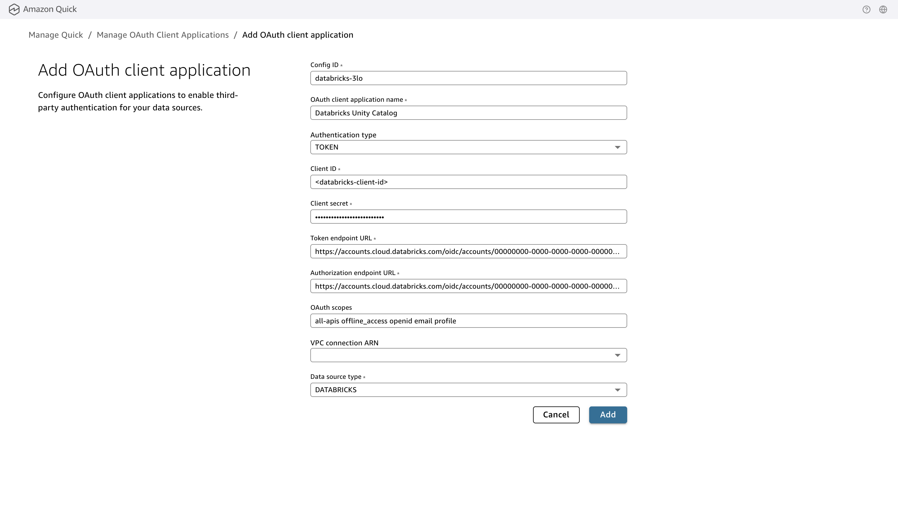

!!! note

    In the screenshot, the account ID is replaced by `00000000-0000-0000-0000-000000000000` and the Client ID by a placeholder. Use your own values.

**3)** Choose **Add** to save the client application

## Part 4 - Create the Databricks data source with 3LO (author)

**1)** In Amazon Quick, go to **Data** → **Data sources**, then choose **Create data source**

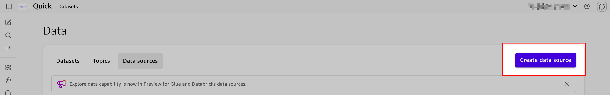

**2)** Select **Databricks** and choose **Next**

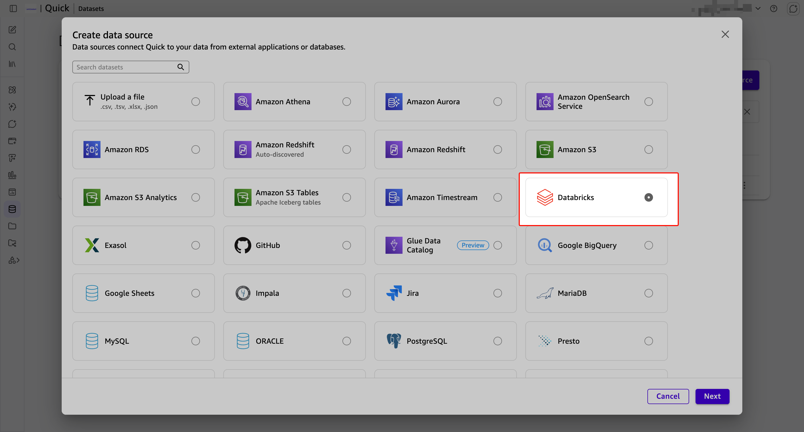

**3)** In **New Databricks data source**, insert the following data:

**Data source name**: for example:

```text
databricks-uc-3lo
```

**Connection type**: `Public network` (or your VPC connection)

**Database server**: your workspace host name, for example `dbc-xxxxxxxx-xxxx.cloud.databricks.com`

**HTTP Path**: from your SQL warehouse in Databricks (**SQL Warehouses** → your warehouse → **Connection details**), for example:

```text
/sql/1.0/warehouses/<warehouse-id>
```

**Port**:

```text
443
```

**Authentication Type**: `3LO`

**Username**: the email address of your Databricks user (see the note below)

**OAuth client application**: the client application from Part 3

!!! info "Username is only used for the first connection"

    Quick uses it to start the OAuth sign-in and validate the data source when you create it. After that, each user authenticates with their own Databricks credentials through the OAuth flow.

**4)** Select **Trusted Identity Propagation**

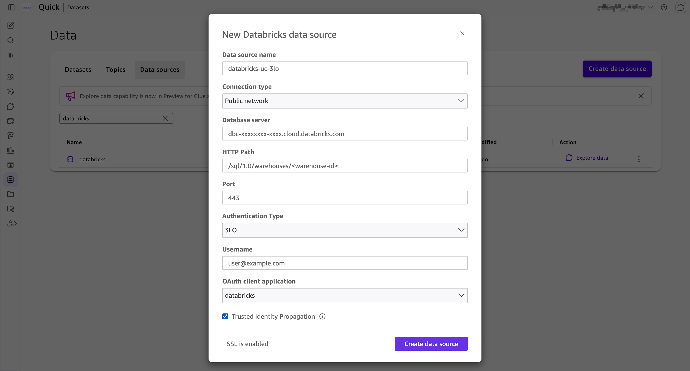

!!! danger "Trusted Identity Propagation is mandatory"

    Check it if you want Quick to assume the credentials of each end user.

    - **Checked**: every query runs with the Databricks identity of the user who views the data, so their Unity Catalog permissions (table access, row filters, column masks) apply.
    - **Not checked**: every user shares the author's Databricks credentials and permissions.

**5)** Choose **Create data source**

A sign-in window opens: log in to Databricks and allow access for the `Amazon Quick` app connection.

## Part 5 - Use the Databricks data source

You can use the Databricks data source in **two ways**.

### Option A - Agentic mode (Explore data)

**1)** In Amazon Quick, go to **Data** → **Data sources**

**2)** On the Databricks data source row, choose **Explore data**


**3)** A conversation opens: ask questions in natural language to discover catalogs, schemas and tables, and to create datasets and topics from them

!!! tip "Agentic catalog experience"

    The agentic experience (discover, create, inherit semantics) works with both PAT and 3LO authentication.

    With 3LO and **Trusted Identity Propagation**, the conversation only shows what your Unity Catalog permissions allow.

### Option B - Dataset source

**1)** In Amazon Quick, go to **Data** → **Datasets**, then choose **Create dataset**

**2)** Select the Databricks data source created in Part 4

**3)** Choose the catalog, schema and table (or write a custom query)

**4)** Select **Directly query your data** (DirectQuery), then build your analyses, topics and dashboards

!!! warning "Keep DirectQuery for identity enforcement"

    Per-user permissions apply only to **DirectQuery** datasets. If you switch the dataset to SPICE or apply transformations, every user sees the same data.

## Part 6 - End-user experience

**1)** The author shares both the **data source** and the **dashboard** with the end user.

**2)** The end user signs in to Amazon Quick, opens the **Data source** page, enters their own Databricks credentials (OAuth sign-in) and saves.

**3)** When the end user opens the dashboard, they see only the data their Unity Catalog permissions allow.

## Troubleshooting

- **`redirect_uri` mismatch**: the redirect URL in Databricks (Part 1, step 3) must exactly match `https://<region>.quicksight.aws.amazon.com/sn/oauthcallback` for the Region of your Quick account.
- **`invalid_client`**: check the Client ID and Client secret (Part 1, step 6), and that the token and authorization URLs contain your Databricks account ID.
- **Federation policy error**: the token sent by Quick is rejected because no federation policy accepts it. Create the policy from Part 2, step 2. The error message shows the exact expected issuer and audience.
- **Users see the author's data**: **Trusted Identity Propagation** was not selected (Part 4, step 4), or the dataset uses SPICE instead of DirectQuery (Part 5, Option B).
- **Least privilege**: Databricks flags `all-apis` as not recommended. If your use case allows it, you can try the narrower `sql` scope instead, and update the OAuth scopes in Part 3, step 2 to match.

</div>
