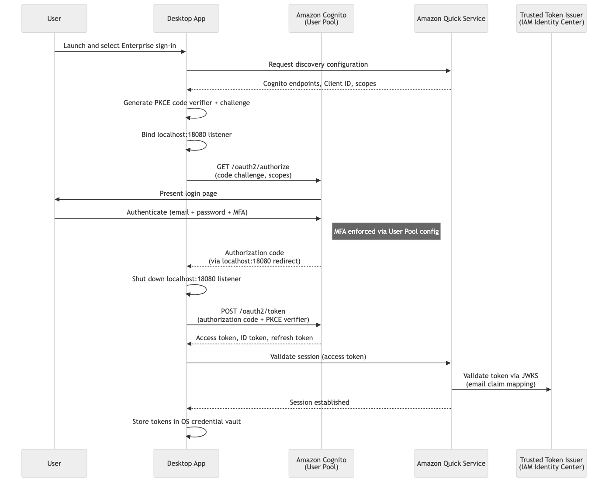

<!-- markdownlint-disable MD033 -->
# AWS Quick on desktop: Cognito OpenID Connect (OIDC) Provider

[AWS Quick on desktop](https://docs.aws.amazon.com/quick/latest/userguide/amazon-quick-desktop.html) uses the **desktop connector** for enterprise sign-in. By default, the connector reuses the sign-in method your AWS Quick account already uses on the web (IAM Identity Center, IAM federation, or Quick-managed users). If a user can sign in to AWS Quick on the web, that user can sign in to the desktop application. You don't need an OpenID Connect (OIDC) provider for this. See [Setting up AWS Quick on desktop for enterprise deployments](https://docs.aws.amazon.com/quick/latest/userguide/desktop-enterprise-setup.html).

A dedicated OIDC configuration is **optional**. Use it only if you need to manage desktop sign-in separately from web and mobile sign-in. See [Using a dedicated identity provider configuration (advanced)](https://docs.aws.amazon.com/quick/latest/userguide/desktop-enterprise-advanced-idp.html). AWS documents this for Microsoft Entra ID, Google Workspace, Okta, and Ping Identity.

This sample, deployable through the AWS Cloud Development Kit (CDK) and AWS CloudFormation, deploys [Amazon Cognito](https://docs.aws.amazon.com/cognito/latest/developerguide/cognito-user-pools-identity-federation.html) as that dedicated OIDC provider. It is for customers who want a separate desktop sign-in, for example to enforce desktop-specific MFA or password policies. It fits accounts that use local AWS Quick users or AWS IAM Identity Center without a federated identity provider (IdP). The email on each Cognito user must exactly match the user's email in AWS Quick. The [Setup](#setup) and [Keeping users in sync](#keeping-users-in-sync) sections cover deployment and user synchronization.

If you only need desktop access with your existing web sign-in, you don't need this stack. Add the desktop connector with **Use Quick's existing configured sign-in method** as described in [Turning on desktop access](https://docs.aws.amazon.com/quick/latest/userguide/desktop-enterprise-setup.html). If you already have an IdP such as Entra ID, Okta, or Ping Identity and want a dedicated configuration, follow the [advanced setup guide](https://docs.aws.amazon.com/quick/latest/userguide/desktop-enterprise-advanced-idp.html) for your IdP instead.

## Architecture

The following sequence diagram shows the AWS Quick desktop authentication flow:



The stack deploys an Amazon Cognito User Pool with a hosted UI domain and a public app client. The desktop app points directly at the Cognito hosted UI OAuth endpoints (`/oauth2/authorize` and `/oauth2/token`). An admin provisions new users, and each one receives a Cognito invitation email and sets their own password on first sign-in.

## Important security considerations

Review and apply these controls before you use the stack in production, with the AWS reference documentation linked for each one.

### Multi-factor authentication (MFA)

Deploy with `-c mfaRequired=true` to require authenticator-app MFA for all users. See [Adding MFA to a user pool](https://docs.aws.amazon.com/cognito/latest/developerguide/user-pool-settings-mfa.html).

```bash
cdk deploy -c mfaRequired=true
```

### User Pool hardening

The deployed User Pool uses minimal defaults. Review and adjust the configuration in [`lib/construct-groups/identity-provider.ts`](https://github.com/aws-samples/sample-amazon-quick-suite-knowledge-hub/blob/main/quick-desktop-oidc-cognito-setup/lib/construct-groups/identity-provider.ts) to meet your organization's security policies.

| Requirement | CDK property | AWS reference |
|-------------|--------------|---------------|
| Password policy (length, complexity, expiry) | `passwordPolicy` | [Passwords and password policies](https://docs.aws.amazon.com/cognito/latest/developerguide/managing-users-passwords.html) |
| Multi-factor authentication | `mfa`, `mfaSecondFactor` | [Adding MFA](https://docs.aws.amazon.com/cognito/latest/developerguide/user-pool-settings-mfa.html) |
| Account recovery | `accountRecovery` | [Passwords and account recovery](https://docs.aws.amazon.com/cognito/latest/developerguide/managing-users-passwords.html) |
| Advanced security (threat protection / adaptive auth) | `advancedSecurityMode` | [Threat protection](https://docs.aws.amazon.com/cognito/latest/developerguide/cognito-user-pool-settings-threat-protection.html) |
| Custom domain | `customDomain` | [Custom domains](https://docs.aws.amazon.com/cognito/latest/developerguide/cognito-user-pools-add-custom-domain.html) |
| Token validity | `accessTokenValidity`, `idTokenValidity` | [Token expiration](https://docs.aws.amazon.com/cognito/latest/developerguide/amazon-cognito-user-pools-using-tokens-caching-tokens.html) |
| Callback URLs | `callbackUrls` | Not applicable |
| Removal policy (retain on stack delete) | `-c retain=true` | Not applicable |

To enforce MFA and a stricter password policy:

```typescript
this.pool = new cognito.UserPool(this, 'Pool', {
  // ...existing props
  mfa: cognito.Mfa.REQUIRED,
  mfaSecondFactor: { sms: false, otp: true },
  passwordPolicy: {
    minLength: 12,
    requireUppercase: true,
    requireDigits: true,
    requireSymbols: true,
    tempPasswordValidity: Duration.days(3),
  },
  advancedSecurityMode: cognito.AdvancedSecurityMode.ENFORCED,
});
```

For an overview of all user pool security features, see [Using Amazon Cognito user pools security features](https://docs.aws.amazon.com/cognito/latest/developerguide/managing-security.html).

## Prerequisites

Before you deploy, make sure you have the following:

- AWS account with an active AWS Quick Enterprise Edition subscription, in a Region that supports agentic features
- Administrator access to your AWS Quick account
- AWS Quick desktop application version 1.1.4053 or later
- Node.js 18+, AWS CDK CLI, and configured AWS credentials
- Python 3.12+ (user sync script)

## Setup

Follow these steps in order. Steps 1–2 deploy the stack and collect its outputs, steps 3–4 connect it to AWS Quick and provision users, and step 5 signs in.

### Step 1: Deploy the stack

Install dependencies and deploy:

```bash
npm install
cdk deploy
```

To require MFA (authenticator app) for all users:

```bash
cdk deploy -c mfaRequired=true
```

To retain the User Pool when the stack is destroyed:

```bash
cdk deploy -c retain=true
```

### Step 2: Retrieve the stack outputs

You will use these values in Step 3.

```bash
aws cloudformation describe-stacks \
  --stack-name QuickDesktopCognitoStack \
  --query "Stacks[0].Outputs" --output table
```

| Output | Description |
|--------|-------------|
| `PoolId` | Cognito User Pool ID |
| `ClientId` | App client ID (also used as the `aud` claim) |
| `IssuerUrl` | OIDC issuer URL |
| `AuthEndpoint` | Authorization endpoint (Cognito hosted UI) |
| `TokenEndpoint` | Token endpoint (Cognito hosted UI) |
| `JwksUri` | JSON Web Key Set URI |

### Step 3: Add the desktop connector

The connector uses a dedicated identity provider configuration that points at the Cognito User Pool. Add it as follows:

1. Sign in to the AWS Quick console as an administrator.
2. Choose your profile icon, and then choose **Manage account**.
3. In the navigation pane, choose **Inbound connectors**. Then choose the **Quick Desktop** tab.
4. Choose **Add desktop connector**.
5. For the identity setup, choose **Configure Identity Provider**, and enter the Step 2 outputs:

    | AWS Quick field | Stack output |
    |--------------------|--------------|
    | Issuer URL | `IssuerUrl` |
    | Authorization endpoint | `AuthEndpoint` |
    | Token endpoint | `TokenEndpoint` |
    | JWKS URI | `JwksUri` |
    | Client ID | `ClientId` |

6. Choose **Confirm**. Then verify that the connector card shows the name **Quick Desktop** and the status **Enabled**.

> **Important:** Adding the desktop connector turns on desktop access for all users in the account right away. To roll out in stages, first restrict the Quick desktop capability in a [custom permissions](https://docs.aws.amazon.com/quick/latest/userguide/custom-permissions.html) profile.

If your account already uses a desktop **extension** from an earlier version of this sample, that setup keeps working. To move to the connector, follow the steps in [Moving from the desktop extension to the desktop connector](https://docs.aws.amazon.com/quick/latest/userguide/desktop-enterprise-setup.html). Before you delete the extension, update every device to version 1.1.4053 or later.

### Step 4: Create and sync users

The included script copies users from IAM Identity Center or local AWS Quick into the Cognito User Pool. It finds the pool ID from the deployed stack on its own. It then shows a plan and asks for confirmation before it creates each user.

```bash
python3 scripts/sync_users.py --source idc    # from IAM Identity Center
python3 scripts/sync_users.py --source local  # from local AWS Quick users
```

Each created user receives a Cognito invitation email containing their username and a one-time temporary password generated by Cognito. On first sign-in they must set their own password. The administrator never sets or sees it. For users who already exist but have not yet signed in, the script offers to resend the invitation. Requires Python 3.12+ and `boto3`.

The invitation arrives from an address like `no-reply@verificationemail.com <no-reply@verificationemail.com>` with the subject **"[EXTERNAL] Your temporary password"** and a body such as:

> Your username is <your user name> and temporary password is <your password>.

These are the credentials for signing into AWS Quick on desktop.

The email on each Cognito user must exactly match the user's email in AWS Quick.

> **Email delivery:** By default the User Pool sends invitation emails using Cognito's built-in email, which is rate-limited and intended for testing. For production, configure Amazon SES on the User Pool.

### Step 5: Sign in

Launch the AWS Quick desktop application and choose **Continue with SSO**. Your browser needs an active AWS Quick web session. If there isn't one, it prompts you to sign in to AWS Quick on the web first. AWS Quick then redirects to the Cognito hosted UI, where you sign in with your email and the temporary password from the invitation email (and MFA, if enabled). On first sign-in you set your own password. The desktop app stores the resulting tokens in the OS credential vault.

A desktop session ends after 30 days or when the Cognito session limit is reached, whichever comes first.

## Keeping users in sync

The sync script is a manual, interactive tool for initial provisioning. It does not run automatically, does not detect removed users, and requires re-running whenever your identity source changes.

For production, you need an automated mechanism. You could trigger a Lambda function on a schedule (or in response to IAM Identity Center events) that reconciles users between your source of truth and the Cognito pool. If your upstream IdP supports System for Cross-domain Identity Management (SCIM), a connector or middleware can push user lifecycle events to Cognito directly. Alternatively, maintain a user manifest in source control and sync it on merge via a pipeline step.

The sync script's `CognitoUserSyncer` and lister classes can be extracted into a Lambda function with minimal changes. Without automated sync, users added or removed from your identity source won't be reflected in the pool until you manually intervene.

## Cleanup

Before you destroy the stack, update or remove the desktop connector so it no longer points at the Cognito User Pool. You find it in the AWS Quick console under **Manage account** > **Inbound connectors** > **Quick Desktop**. Otherwise desktop sign-in fails after the pool is deleted. Removing the connector turns off desktop access for all users.

```bash
cdk destroy
```

If you set up a desktop extension with an earlier version of this sample, delete it on the **Extensions** page in the AWS Quick console.

## Security

See [CONTRIBUTING](https://github.com/aws-samples/sample-amazon-quick-suite-knowledge-hub/blob/main/CONTRIBUTING.md#security-issue-notifications) for more information.

## License

This sample is licensed under the MIT-0 License. See the repository [LICENSE](https://github.com/aws-samples/sample-amazon-quick-suite-knowledge-hub/blob/main/LICENSE).
